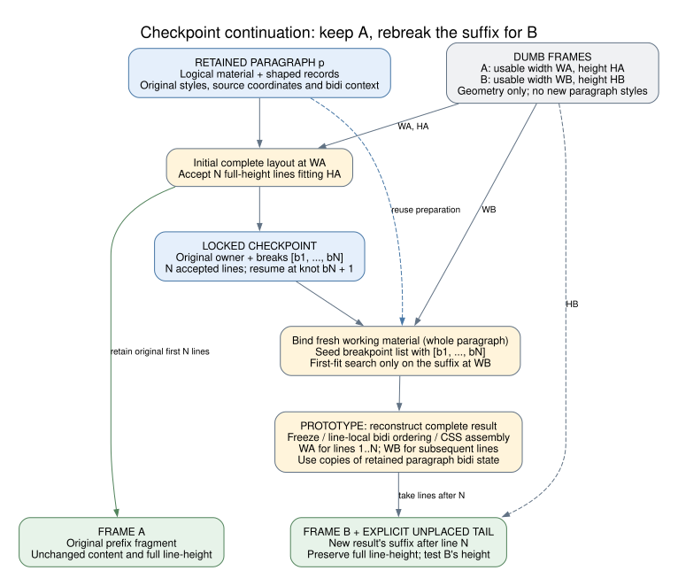

> This document records design or measurements from an earlier execution API.
> For the supported preparation, trial, checkpoint and prefix-refitting APIs,
> use the [paragraph guide](../glyphing/paragraph/README.md). Historical timings
> are not measurements of the current implementation.

# Paragraph flow across frames of different sizes

Context policy (2026-11-19): typesetting, geometry, retained proofs, replay,
and document execution are synchronous and have no context argument. Contexts
are confined to streaming coordination and font discovery/loading. Streaming
callers create a local background context; consumer failure still cancels and
joins the producer before cleanup. Errors publish no partial result and preserve
previous immutable output. TUI layout jobs finish serially; stale results are
discarded, while font work remains cancellable. This supersedes earlier
cancellation requirements for typesetting in this document.

Investigation and production plan: 2026-11-18. This document records current
capabilities, experimental evidence and staged production work. P1's geometry-only
height cuts and P2's khipu checkpoint/seeded first-fit primitives are implemented.
P3 adds typography continuation/dispatch, P4 retained fragment rendering, and P5
a bounded document/CLI frame invocation. P6 validates the bounded production
profile and records [production cost evidence](FLOW_COSTS.md). Restacking, elasticity and general
page-breaking remain deferred. The existing
[VList contract](VLIST_CONTRACT.md) and [unboxing/restacking plan](VLIST_PLAN.md)
remain unchanged.

## Agreed direction and bounded experiment

Decision, 2026-11-18: paragraph-global breakpoint optimization is not required
for region flow. Preserve the accepted prefix and rebreak only its continuation.
The expected frequent case is equal-width flow across exactly two frames (the
90% share is a workload assumption to evaluate). Prioritize frozen-line reuse for
that case, guarded by unchanged layout-affecting inputs rather than width alone.

The [archived flow experiment](history/flowexperiment/README.md) preserves
three stages: equal-width splitting, fixed-prefix continuation correctness, and
cost/decision measurements. The active package is retired; its evidence and inert
source snapshots remain available for historical review. E1 implemented the internal equal-width experiment
using existing immutable fragments; see its [evidence and limitations](history/flowexperiment/RESULTS.md).
E2 tested a bounded first-fit continuation against a constrained reference,
using temporary owning-package overlays. Its [results](history/flowexperiment/E2_RESULTS.md)
distinguish suffix-only breakpoint search from the still-complete binding and
materialization pipeline, and record upstream bidi preparation rejection and
progress limits. Some mixed RTL input stalls before continuation; cancellation
cannot interrupt the synchronous bidi resolver. That upstream fix remains deferred.
E3 recorded [cost comparisons and the decision](history/flowexperiment/E3_RESULTS.md):
compatible equal-width fragmentation is substantially cheaper in the bounded
measurements, while narrower continuation still binds, freezes and assembles the
whole paragraph. Those are historical experiment conclusions; P1–P6 now provide
the bounded application integration and production validation. The upstream bidi
fix remains deferred.
Global optimization remains background comparison material below, not a
requirement for this experiment. The [production plan below](#staged-production-plan)
defines API responsibilities and acceptance gates. P1–P5 signatures are now
implemented and P6 verification is complete for the explicitly bounded profile.

## Checkpoint-based continuation: the working model

Frames are **dumb box containers**, like small pages. The application may describe
them with DIVs and CSS, but the paragraph pipeline receives resolved content
widths, available heights and placement information. Padding and borders reduce
the usable area; surrounding margins remain application-owned. Moving into B
does not make `p` inherit B's font, size, language, direction or line-height.
The frame supplies geometry; `p` keeps its own typography and paragraph context.
The bounded model also keeps inline-object dimensions fixed.

Prepare `p` once and retain its logical material, shaped records, original styles,
source/feature coordinates and paragraph bidi analysis. With reflow PRs 1–2,
`paragraph.Prepared` retains immutable Khipu material and matching Discovery.
Binding shares base knots and copies atomic advances; each breaker publishes an
independent Tikray. It does not re-itemize or
re-encode the source, select fonts, or reshape base text. Neither Unbox nor the
physical knots of an old frozen line supply the logical continuation.

The E2/E3 continuation is a **resumable breaker with an explicit checkpoint**:

1. Lay out `p` at A's width. Accept `N` complete lines that fit A's available
   height, preserving every full CSS line box.
2. Capture all `N` accepted logical knot breakpoints in an immutable checkpoint
   tied to the original preparation and initial result. The last is the A/B
   boundary. A height or a source byte offset alone is insufficient.
3. Bind fresh working material from the retained preparation. Seed the breaker's
   output with those locked breakpoints and resume its search immediately after
   the last accepted knot. Normal line-edge trimming still applies. No newline,
   paragraph separator or new penalty is inserted into the source/material.
4. Keep a stable width schedule: A's width for original line numbers `1..N`,
   B's width thereafter. E2 uses first-fit for the suffix even when the initial
   prefix came from Knuth–Plass. No accepted breakpoint can move.
5. The prototype freezes and assembles a **complete** result from this combined
   path, using the same width schedule. Publish the original A fragment and the
   new result's suffix after line `N` as B plus any explicit unplaced tail. A's
   original frozen content and geometry remain unchanged.

For example, these are illustrative logical knot indexes, not byte offsets:

```text
Initial breaks at A's width:  [12, 25, 38, 51, 64]
A accepts two lines:         [12, 25]                 <- locked checkpoint
Resume search at knot:       26
Combined continuation:       [12, 25, 33, 41, 49, 57, 64]
Line widths:                 [WA, WA, WB, WB, WB, WB, WB]
Published content:           original A | new B and any tail
```

The entire paragraph is **not rebroken at B's width**. Only the suffix gets new
breakpoint decisions; full binding, freezing and assembly are the prototype's
remaining repeated work. E3's `relayout-narrow` benchmark does rebreak the whole
paragraph at B's width, but it is solely a cost comparator and cannot preserve
the accepted-prefix contract.



The diagram shows the resumed candidate at an interior cut, including its
complete-result reconstruction. With `N = 0`, search starts at the beginning;
if everything fits A, the initial result is reused without continuation.
[Editable Graphviz DOT source](FLOW_CONTINUATION.dot).
From the typography root, regenerate the image with:

```sh
dot -Tsvg doc/FLOW_CONTINUATION.dot -o doc/FLOW_CONTINUATION.svg
```

The historical prototype seams are the [owner-bound checkpoint](history/flowexperiment/testdata/e2/khipu.go.txt),
[seeded breaker entry](history/flowexperiment/e2_overlay.py.txt), and
[continuation width schedule](history/flowexperiment/testdata/e2/paragraph.go.txt).
Those snapshots are retired overlays. Current production implementations are
[khipu checkpoints](../../khipu/checkpoint.go),
[seeded first-fit](../../khipu/linebreak/firstfit/continue.go), and
[typography continuation](../glyphing/paragraph/flow.go). Here, resumability means a fresh call
with retained context; it does not mean resuming a suspended Knuth–Plass search
or permitting concurrent calls on one preparation. Shared preparation and services
still require serialized use. NoHyphenation makes ordinary checkpoints sufficient
for the admitted cases; discretionary carry needs a separate extension.

Different-width flow is a required capability for the intended use cases even
when it costs more than equal-width splitting. A correct bounded implementation
may initially retain the complete binding/freezing/assembly path. The accepted
trade-off is fixed-prefix stability with first-fit continuation and no
paragraph-global optimum, not losing content or weakening geometry/ownership.

## Staged production plan

Deliver a bounded, usable continuation path across khipu, typography and **tycli**.
Tycli lives in the tytui module and uses its headless `documentlayout` adapter;
this plan does not require the TUI or its paragraph mode. Equal-width reuse is
the normal dispatch path. Different-width continuation is part of the baseline,
with complete binding, freezing and CSS assembly explicitly accepted. Range-only
assembly, candidate-at-a-time measurement and a general page scheduler are later
optimizations/extensions, not prerequisites for this delivery.

P1–P6 are implemented (2026-11-18): geometry reuse, khipu checkpoints, typography
continuation/dispatch, retained fragment proof/export, bounded document/CLI frame
flow and production verification/cost evidence. See [the P6 report](FLOW_COSTS.md).
Generalized flow and the upstream bidi fix remain deferred.
P0's ownership/reuse contract informs these narrow APIs, but
the broader multi-paragraph flow protocol is not implemented. Each stage is a separate reviewable
change. P1 and P2 are independent after P0; P3 combines them. P4 and
P5 supply the retained rendering and application lifetime needed for a usable
CLI result. P6 completes validation of this bounded baseline for both equal and
different widths, without claiming unrestricted document fragmentation.

### P0 — Fix the bounded contract and ownership boundaries

**Owners:** khipu, typography and `tytui/documentlayout`, with tycli as the first
consumer. Agree the following before exposing production methods:

- One prepared paragraph, stable styles/fonts/services, CSS full line-height,
  fixed atomic geometry, NoHyphenation and the current Latin/Hebrew scope. Frames
  supply resolved content geometry only. Initial layout may use first-fit or KP;
  compatible retained lines keep that layout, while any new suffix search uses
  first-fit. Record this policy explicitly in results/diagnostics.
- Use one-frame-at-a-time operations over a finite application-supplied frame
  sequence. Optimize the two-frame case, but retain enough history for A/B/C
  continuation. Every ordinary line boundary is eligible initially; widows,
  orphans, keep rules and paragraph-global quality optimization are deferred.
- Return `complete`, `continues` or `noProgress`, plus independent horizontal
  overflow diagnostics. An exhausted frame sequence retains a complete explicit
  remainder/continuation. Oversized lines cannot be silently dropped or claimed
  to fit. Empty input and zero-height lines have explicit progress semantics.
- Context cancellation or any error publishes no new partial result and leaves
  the previous continuation, preparation and accepted fragments reusable. A
  successful incomplete result is an explicit outcome, not a partial error.
  Serialize operations sharing preparation and borrowed services.

Keep the public concepts small; names below describe roles, not final signatures:

| Owner | Proposed responsibility | Excluded state |
| --- | --- | --- |
| khipu | Opaque preparation-bound breakpoint checkpoint, certified from a successful path; seeded first-fit invocation | Frame heights, CSS, paint, rendering |
| typography/glyphing/paragraph | Private prepared-flow state; immutable continuation tokens; height cuts, reuse dispatch and complete CSS assembly | DOM, discovery, frame styling |
| typography/layout | Existing immutable Fragment/VList data and validated local geometry | Mutable checkpoints, composite VLists pretending to have one owner |
| typography/render | Retained fragment proof traversal | Shaping, breaking, restacking, line metrics |
| tytui/documentlayout | Invocation lifetime, frame sequence, group/source/paint/margin associations and positioned fragments | A second line breaker or CSS sizing algorithm |
| tycli | Explicit flow request, diagnostics and complete SVG publication | Font discovery, hidden reflow during export |

Keep working preparations out of published document snapshots. An opaque
continuation retains its private owner only while that paragraph is unfinished
and continuation/retry is needed. Completed fragment results retain stable frozen
content/services and detached placement/source metadata. No elastic planes or
public parsed-font accessors escape. No checkpoint or backend service is serialized.

#### Paragraph lifecycle

Process paragraphs in turn, with temporary preparation for the current paragraph:

1. Prepare `p` once, retaining its logical material, styles and bidi context.
2. Flow `p` through as many supplied frames as it needs. Keep preparation and
   checkpoints while any remainder is unplaced; creating the first VList or
   filling A is not paragraph completion.
3. Once all of `p` has been placed successfully, keep its frozen fragments and
   rendering/source/paint/margin associations. Drop the preparation, checkpoints,
   continuation handles and temporary binding/assembly state before advancing
   to the next paragraph. Do not wait for document export or document completion.
4. Prepare and flow the next paragraph under the same rule. Completed paragraphs
   do not accumulate in a document-wide preparation cache.

In Go, release means dropping all owning references so garbage collection can
reclaim the working state; it does not promise immediate deallocation. A retained
checkpoint can keep its preparation alive, so invocation tables and histories
must remove those references too. Frozen fragments continue to retain whatever
immutable glyph, source and font/service data they need, without retaining a
working preparation merely to render them.

The source-text handle shared with frozen output is allocated independently of
`Prepared`; a pointer into its fields would otherwise retain the whole preparation.
GC regressions keep frozen fragments alive while checking that preparation is
collected after ordinary layout, equal-width flow and changed-width continuation.

An incomplete or failed attempt keeps the prior state available for an explicit
retry. If the caller abandons that paragraph/invocation, it releases those handles
as well. Revising a finalized paragraph after release requires a fresh preparation;
there is no implicit permanent cache. This lifecycle applies to P5's single-paragraph
flow invocation and to a later multi-paragraph scheduler; it does not add general
document pagination to P5's scope.

**Gate:** document request/result/error semantics, copied versus borrowed state,
units and admission policy. Treat the E2 bidi failures as existing preparation
limitations, not accepted output or a reason to reinterpret frame boundaries.
Their upstream fix remains separate; P6 defines the production exposure gate.

### P1 — Promote the geometry-only equal-width path

**Implemented:** `paragraph.FitFragment(fragment, sourceKey, targetKey, height)`
returns placed/remainder fragments, vertical status and original-index horizontal
overflow diagnostics. `FragmentReuseKey` is a caller attestation with width,
original skip triples and nonzero input revisions. P1 checks the whole frozen
owner's uniform width, including suppressed-empty diagnostics. Keys retain no
preparation/services; P3 handles heterogeneous owners and width-change dispatch.
See [API and lifetime guidance](../glyphing/paragraph/README.md#equal-width-height-cuts)
and [implementation](../glyphing/paragraph/fragment_fit.go). The experiment and
its historical performance evidence are unchanged; production cost evidence is
recorded separately in [P6](FLOW_COSTS.md).

**Owner:** `typography/glyphing/paragraph`, using `layout.Fragment`. Add a narrow
height-cut operation over retained fragments, derived from E1, and keep its core
free of preparation, font-service and breaker handles. Handle cuts at zero/end
without passing illegal boundaries to `SplitFragment`.

The later flow dispatcher supplies a compatibility certificate derived from its
own retained preparation/request: original width and skip triples, source/style
identity, selected fonts, line-height, atomics and policy. Equality of numeric
widths alone is insufficient. Keep borrowed faces/styles stable; certificates do
not detect arbitrary mutation of those objects. Heights and frame origins may
change. Do not load fonts, query metrics or create a working binding to decide
whether reuse is possible.

Find the last fitting authoritative line-box end without adding an overflow
epsilon. Preserve zero-height lines, suppressed-empty diagnostics, signed
extents, finite-domain validation and original source/knot coordinates. Return
the placed fragment and an explicit remainder, sharing immutable frozen content.

**Gate:** migrate the E1 correctness cases to owning tests, including compatibility
refusal, exact/near-fit heights, empty frames, repeated splitting, detached
geometry, cancellation and retry. Service traps and a resolved-call audit prove
zero additional itemization, shaping, acceptance, metrics, binding and breaker
calls after initial layout. Geometric validation/copying remains permitted.

**P1 verification (2026-11-18):** owning regressions and the resolved-call audit
pass, including repeated fits, suppressed-empty ownership, strict fit despite
arithmetic tolerance, derived input/output depth bounds and cancellation at every
observed checkpoint. Ordinary/race suites, build and vet passed in typography,
tytui, khipu and css-box-layout with production sources. Full suites include the
generic dependency audits, adapter regressions and current replay/tycli controls.
No new performance claim is made; E3 benchmark evidence was not regenerated.

### P2 — Add a production checkpoint and seeded first-fit entry in khipu

**Implemented, API updated by reflow PRs 1–2:** `khipu.Checkpoint(plan, acceptedLines)`
returns an opaque `BreakCheckpoint` from a complete immutable Tikray. Publication
of that plan has already validated path legality, mandatory boundaries, captured
geometry and selected alternatives. Both FF and KP prefixes, zero accepted lines
and fully accepted paths are supported under NoHyphenation.

`firstfit.ContinueParagraph(BreakRequest{Prefix: checkpoint, ...}, options)` uses
the ordinary first-fit loop after the last locked knot. `SeedFor(binding)` checks
incarnation and consumed atomic advances and returns detached prefix decisions,
without prefix search or width queries. The checkpoint supplies accepted widths
and skips; the request supplies suffix geometry. `Freeze(plan)` uses the resulting
captured geometry without a separate width schedule or shape callback.

Search is synchronous and context-free. It performs no base shaping, CheckFace
or discretionary work. An independent successful continued Tikray can certify a
longer checkpoint; older plans remain unchanged. No experimental API is exposed.

See the [checkpoint implementation](../../khipu/checkpoint.go),
[continuation entry](../../khipu/linebreak/firstfit/continue.go), and
[client/lifetime guide](../../khipu/doc/PREPARED_PARAGRAPHS.md#checkpoint-continuation).
Checkpoints retain preparation until each paragraph finishes or is abandoned;
drop them and working bindings then. Frozen results retain no working preparation
or checkpoint. The P1 geometry-only path is preserved by P3's dispatch below;
Retained fragment rendering and bounded scheduling are provided by P4/P5 below.

**Owner:** khipu and `linebreak/firstfit`. Replace the experimental seam with an
opaque checkpoint certified from a complete immutable Tikray. Retain copied
prefix decisions, incarnation identity and consumed atomic advances. Reject nil/uninitialized handles, foreign preparations, non-monotone
indexes, prohibited boundaries and skipped mandatory breaks. Do not accept an
arbitrary source byte offset as a checkpoint or let callers mutate its boundaries.

Add a first-fit entry that seeds the accepted breakpoints and starts at the next
logical knot, using the existing loop and normal trimming/paragraph-end rules.
Keep ordinary first-fit calls unchanged. NoHyphenation is an explicit admission
check before relying on empty replacement carry. Accept a checkpoint after a KP
prefix without attempting to resume KP's internal optimization state.

Allow a new checkpoint to be certified from a successful continuation path, so
later calls can lock newly accepted B lines as well as A's original lines. Keep
the checkpoint independent of mutable working arrays and frozen visual order.
The caller supplies a stable line-number width schedule to breaking and freezing.

**Gate:** independent breakpoint examples and a constrained reference agree;
accepted boundaries never move, prefix search visits are zero on resumed calls,
and full binding/materialization remains allowed. Cover wrong owners, zero-value
seeds, forced breaks, cancellation inside search, failure/retry and a genuinely
different KP prefix. Check source coverage and final paragraph fill, not just
counts. No new base shaping or CheckFace calls may occur.

**P2 verification (2026-11-18):** owning tests pass for complete-path validation,
foreign/zero handles, detached prefixes, mandatory breaks, independent breakpoint
examples, constrained-reference agreement, a genuinely distinct KP prefix, A/B/C
checkpoint extension, source coverage/final fill, cancellation at every observed
check and failure/retry. Search-visit counts exclude all prefix knots; sealed
preparation-service traps enforce no new resolution, shaper creation, shaping or
CheckFace calls. Frozen output remains readable after working handles leave scope.
Ordinary/race suites, build and vet passed with production sources in khipu,
typography, tytui and css-box-layout, including P1's zero-work audit, dependency
audits, adapter regressions and replay/tycli controls. The adapted E2/E3 overlay
passes ordinary/race experiment regressions and khipu/first-fit owning tests.
Historical measurements and fixtures were not regenerated; no new performance
claim or upstream bidi fix is part of P2.

### P3 — Add typography continuation with full assembly and unified dispatch

**Implemented:** `Prepared.StartFlow(LayoutRequest)` returns an opaque
`Continuation`; `Continuation.Fit(Frame)` returns a detached `FlowResult`
with placed/remainder fragments, progress/overflow diagnostics and a new token
only while content remains. Frame supplies width (DU) and height (big points).
The fixed private state owns copied layout/atomic values and borrowed stable
source/styles/fonts/services. It admits only NoHyphenation. Input changes other
than frame dimensions require a new flow; there is no implicit style update.

The token is the compatibility certificate: same state, same retained tail width
means geometry-only reuse. P1's fitting core is shared, with private width-history
validation for heterogeneous owners; public FitFragment keeps its uniform-owner
guard. Equal-width fitting needs no checkpoint, binding or service call. When
width changes, a P2 checkpoint is certified lazily from the previous complete
successful path and accepted line count, then used for a fresh first-fit suffix
search. Shared production helpers finish the complete freeze/CSS assembly.

Every committed A/B/... width is retained, so a later C width cannot overwrite
B's widths. Previously published fragments are left intact and retained by the
caller, not chained through the token. No synthetic single-owner VList is made.
Results expose the suffix breaker and whether geometry was reused. Empty input
completes without reflow even if width changes; oversized lines give explicit
no-progress/remainder or horizontal overflow, never silent loss.

Completed results contain no working token. Callers drop preparation and all old
tokens after each paragraph finishes or is abandoned; frozen fragments remain
usable. Checkpoints and bound material are invocation-local temporaries. See
[API/lifecycle guidance](../glyphing/paragraph/README.md#checkpoint-based-frame-flow),
[dispatcher](../glyphing/paragraph/flow.go) and
[width-change path](../glyphing/paragraph/flow_reflow.go). No rendering, application
scheduler, replay changes or upstream bidi fix is included in P3. P4 adds retained
rendering below; P5 supplies bounded application flow and P6 validates that profile.

**Owner:** `typography/glyphing/paragraph`. Retain the preparation, source styles,
original paragraph bidi analysis, copied line-height/atomic/skip configuration,
certified path and accepted line count behind an opaque flow handle/token. Keep
the ordinary `Prepared.Layout` contract intact. Use shared production finishing
helpers rather than maintaining a second freeze/CSS assembly implementation.

For each next frame, first compare the retained remainder's compatibility
certificate with the new request. If compatible, use P1 directly. Otherwise, for
an admitted width-only change, make a fresh full binding, use P2 to rebreak only
the suffix and run the existing **complete** freeze and CSS assembly pipeline.
Source, fonts, styles, line-height or atomic changes invalidate this continuation;
they require a new layout invocation and must not silently alter committed lines.

Retain the width schedule of **every committed line**, not merely the original
A width. For A→B→C, a checkpoint after B contains all accepted A and B boundaries;
freezing uses their original widths and C's width only for the new suffix. Extend
the schedule from successful results, never by guessing source offsets. If C
matches the existing unplaced B-width tail, reuse that tail even though its full
frozen owner also contains earlier A-width lines. Validate the retained range
and its certified history rather than demanding uniform width throughout that
heterogeneous owner. Preserve suppressed-empty validation at session entry.

At publication, keep all previously accepted fragments exactly. New suffix
fragments refer to the newly assembled complete frozen owner. A result may thus
retain several owners; it is a sequence of fragments, not a synthetic VList
joining incompatible owners. Rebase new local geometry once, preserve full
line-height/source coordinates and leave margins to the application. A successful
operation returns a new continuation only if content remains. Completion returns
frozen output without a working continuation, allowing preparation/checkpoints
to be released under P0's lifecycle; failed attempts change no prior state.

Clone retained bidi resolution for line-local L1/order processing with new
boundaries; do not rerun paragraph analysis or invoke markup again. Preserve
source styles for space/strut metrics. Repeated prefix metric work and allocations
are accepted initially, while base shaping and font acceptance stay at zero.

**Gate:** E2 oracles pass against production APIs, including fixed-prefix content
and geometry, bidi/isolate context, spaces, varying line heights, signed/zero
atomics and late assembly failures. Add repeated A/B/C width changes, equal→narrow
and narrow→equal dispatch, empty/full cuts, exhausted frames and immutable older
results. Verify that cancellation/errors retain their causes and stages and
never publish half a continuation. Equal-width calls still satisfy P1's zero-work
service/breaker gate; different widths may visit/assemble the complete paragraph.

**P3 verification (2026-11-18):** production owning tests cover independent
breakpoint examples, distinct KP prefixes, A/B/C width history and heterogeneous
tail reuse, source coverage/final fill, frozen prefix glyphs, full line heights,
signed/zero atomics, mixed sizes/spaces, feature domains and retained bidi/markup.
They exercise invalid/zero handles, empty/oversized frames, cancellation at every
observed check, late assembly failures, retry and completed-result lifetime.
Service counters enforce zero base shaping/CheckFace on changed widths; sealed
services plus a resolved-call audit of the equal-width dispatch enforce the
geometry-only boundary. P1's existing audit and regressions remain green.
Ordinary/race suites, build and vet passed in typography, tytui, khipu and
css-box-layout, including dependency audits, adapters and current replay/tycli
controls. E2/E3 overlay regressions passed ordinarily and under race detection.
Historical fixture and timing evidence was not regenerated; the upstream bidi
limitation remains deferred. P4 rendering is documented below.

### P4 — Render positioned fragments without relayout

**Implemented (2026-11-18):** `render.BuildFragmentProof(FragmentInput,
Services)` returns the existing detached `ParagraphProof` type. The input carries
one immutable `layout.Fragment` plus the whole paragraph's processed text and
paint. `Glyph.Line` is fragment-local; frozen knot indexes and UTF-8 anchors stay
original. Empty ranges draw nothing. The ordinary and fragment entry points share
the same internal walker, preserving outline/order/error precedence.

`tytui/documentlayout.BuildFragmentProof(result, placements, services)` and
`WriteFragmentSVG` compose explicit `PositionedFragment` values. Each associates
a GroupID and fragment with `FrameOrigin` plus `Offset`, both in big points.
Their sum is the fragment origin; the old owner's origin is not added. Callers
retain the matching group styles/paint/fixed atomic geometry; the API checks the
full source bytes against that group and accepts different frozen continuation
owners. It follows only selected atomic placements into retained child subtrees,
preserving exact border origins and child content edges without CSS narrowing.
Nested paragraphs and diagnostic leaves/images use their existing retained data.
No outside ancestor box is synthesized or repeated across frames.

The ordered placement list is an explicit drawing request, not a flow protocol:
callers choose ranges and destinations. Repeated placements deliberately repeat
content; gaps are allowed for partial inspection. Line indexes are local to each
placed fragment or opaque child paragraph; group/source identities stay original.
Surrounding margins remain application-owned and already accounted for in offsets.
The APIs retain no working preparation/continuation/result handle in the proof,
and never change the equal-width fitter. P5 below supplies bounded scheduling,
frozen flow results and CLI requests. No fixture/replay changes or upstream bidi fix belong here.

**Owners:** `typography/render` and `tytui/documentlayout` proof/export code. Add
retained fragment traversal alongside `BuildParagraphProof`, sharing its internal
walker where practical. Read frozen lines by `FragmentLine.OriginalIndex` while
using fragment-local line/atomic placements. Apply VisualOrder once per detached
directional glyph fragment and preserve original source anchors for paint.

The application composes frame origin, local paragraph placement and atomic-child
origins exactly once. Visit only published fragment ranges; never render the
complete intermediate owner and accidentally repeat A. Keep stable outline and
identity services separate from glyphing, with no branch-to-branch dependency.
Full VList/ordinary document proof APIs remain valid and unchanged in behavior.

**Gate:** compare retained glyphs, anchors and translated geometry with the
original equal-width proof and with narrower continuation oracles. Cover bidi,
ligatures/paint, nested fixed opaque content, negative advances, multiple owners
and late outline failure. Rendering makes no metric, shaping, binding or breaker
calls and returns no partial proof on error.

**P4 verification (2026-11-18):** full ordinary/race suites, build and vet passed
in typography, tytui, khipu and css-box-layout, including dependency audits,
adapter regressions, the equal-width call-boundary tests and current replay/tycli
controls. New owning regressions compare equal-width and narrower continuation
glyph/source/paint/geometry, count directional ordering, render after preparation
collection, and cover real-font ligatures/bidi, multiple owners, nested opaque
children, signed advances, precise atomic origins, empty ranges, source mismatch,
detached results, late outline failure and SVG failure atomicity.
Historical fixtures and experiment measurements were not regenerated. P5 is
documented below; the upstream bidi fix remains deferred.

### P5 — Integrate a bounded flow invocation into documentlayout and tycli

**Implemented (2026-11-18):** `Document.LayoutFlow(FlowRequest, Config)`
accepts `LayoutRequest` (source containing width/breaker) and an ordered copied
`[]FlowFrame` of unique IDs and float64 CSS-pixel content rectangles. The selected
root must contain exactly one direct normalized inline group; every opaque
inline-block requires an explicit pixel width. Other roots/auto-width objects
fail explicitly. CSS still owns original edges and nested child layout. The first
frame width must equal the initial callback's usable width at DU precision.

The root callback calls `Prepared.StartFlow` once and retains its token privately.
Its complete initial fragment records are republished as a validated VList solely
for the existing CSS summary path, with no second layout/freezing/assembly.
Children use ordinary layout and release preparation after their final callbacks.
The frame loop calls `Continuation.Fit` once per attempted frame, logs route,
accepted counts, suffix breaker and overflow, and drops preparation/token as soon
as completion is observed. Exhaustion/failure also abandons working state.

The immutable application `FlowResult` exposes detached `Frames()` diagnostics,
`Group()` source/style/paint input, `SurroundingMargins()`, `Complete()` and a frozen
`Remainder()`. No working checkpoint is published, including on incomplete flow;
retrying with more frames needs a new invocation. Destinations after completion
have `Attempted=false`. Overfull indexes refer only to each placed fragment;
no-progress and horizontal overflow are separate outcomes. Margins are retained
once as source-owner metadata; frames already describe usable content areas.

`BuildFlowProof` permits inspection of placed material in incomplete results.
`WriteFlowSVG` requires completion and supports the existing boxes/glyphs controls,
frame outlines and retained opaque interiors. Boxes-only traversal bypasses font
services. `tycli --frames FILE` accepts exactly one nonempty JSON array of
`{id,x,y,width,height}` records (unknown fields rejected; omitted numerics are zero).
The existing `--width` still describes the source CSS containing width. Failed or
incomplete flow/export leaves the prior file/stdout unchanged; normal invocation
without `--frames` keeps its existing output. See the
[document API](../../tytui/documentlayout/README.md#bounded-paragraph-frame-flow-p5)
and [CLI profile](../../tytui/tycli/README.md#opt-in-paragraph-frames-p5).

This is an opt-in bounded integration profile, not unrestricted production
pagination. The upstream synchronous bidi limitation remains documented; P6
measurements/release work, a general multi-paragraph scheduler and upstream fixes
are deferred. There is no document-flow replay format or change to replay v5.

**Owners:** `tytui/documentlayout` and `tytui/tycli`. Add an explicit frame-flow
entry point alongside ordinary `Document.Layout`. Its first CLI profile selects
one paragraph stream from the chosen root, with a finite ordered list of resolved
content rectangles. Reject unsupported multiple top-level groups, arbitrary
document pagination and objects requiring region-dependent re-sizing; do not
silently omit them. Fixed opaque children may retain their already laid-out
interiors. This delivers the paragraph use case before a general document pager.

Propose an opt-in `--frames FILE` request with frame IDs, origins, widths and
available heights in CSS pixels; finalize its small schema and diagnostics in
this stage. Explicit resolved rectangles are sufficient initially. A later DIV/CSS
frame frontend can produce the same records without changing paragraph APIs or
reparenting `p` into different style contexts. Keep the existing non-flow CLI path
and CSS geometry controls unchanged. Use the adapter's checked CSS-pixel/DU/point
conversions; never substitute `dimen.PX` or narrow before validation.

Preparation lifetime is the main integration change. Today's
[invocation](../../tytui/documentlayout/preparation.go) owns prepared groups and
[completed Result](../../tytui/documentlayout/result.go) exposes only frozen
paragraphs. The new flow invocation retains the preparation and initial certified
path until that paragraph has fully flowed, then removes its working handles
even if later frames or paragraphs remain. Reuse extraction, itemization, paint,
markup and fixed-object preparation; do not call Prepare again after splitting.
CSS still resolves boxes and invokes initial paragraph layout. Capture the flow
handle during that callback, then drive continuation after initial CSS resolution
within the same application invocation. Do not call the existing final callback
repeatedly or weaken its one-attempt-per-group guard. No global or cross-invocation
preparation cache is needed.

Make the first frame's usable paragraph width explicit at this boundary. Resolve
owner edges and fixed children in the original style context and validate that
the initial callback's effective width agrees with that constraint; reject
incompatible fixed-width/container configurations in the first profile. Do not
equate the CLI's outer containing width with the paragraph width before edge
deductions. Capture the handle from the single initial layout, without laying out
the paragraph a second time merely to acquire continuation state.

Add a distinct immutable flow result holding frame placements, fragment owners,
group/source/paint associations and the original surrounding-margin snapshot.
An ordinary geometry-table entry has one origin and cannot represent the same
paragraph in several frames; do not overwrite it for each fragment. Frames in
the first profile describe already usable content areas. Retain margins as owner
metadata and do not deduct/add them again per fragment. Automatic CSS block-edge
decoration or margin behavior at page breaks needs a later explicit policy.

Walk the supplied frames once in order, using P3 dispatch. For an oversized next
line, report no progress for that frame and try the next supplied frame, without
an unbounded retry loop. Preserve any final remainder. The headless API can return
it explicitly; the CLI's first profile should fail an incomplete flow with a
clear diagnostic and leave its output untouched. Horizontal overflow is separately
reported, even when all source has been placed. Empty frames and zero-height lines
must not stall scheduling.

Export frame outlines and P4's retained text/object placements through the current
boxes/glyphs controls. Publish/write only after the complete invocation and SVG
serialization succeed, preserving tycli's existing output replacement behavior.
Trace logs identify the chosen reuse/continuation route, accepted line counts,
frame IDs, suffix policy and overflow, with no hidden reflow during export.

**Gate:** headless and CLI tests cover two equal frames, narrower/wider B, three
frames, source/paint/margin retention, object placement exactly once, CSS padding
and borders, units/rounding, no progress, cancellation, failed export and unchanged
prior output. A font/line-height/direction authored on a frame must not alter `p`.
Verify that finalized paragraphs leave the preparation/checkpoint tables and that
their frozen fragments still render correctly after working handles are discarded.
Check observable ownership and output, not nondeterministic GC timing.
Existing document output remains unchanged without the flow option.

**P5 verification (2026-11-18):** ordinary/race suites, build and vet passed in
typography, tytui, khipu and css-box-layout, including generic dependency audits,
adapter/replay controls, P1/P3 reuse boundaries and ordinary tycli output tests.
New application/CLI regressions cover equal/narrower/wider/three-frame routes,
CSS edges and DU rounding, fixed atomic ownership, detached source/paint/margins,
no-progress/exhaustion, horizontal overflow, no extra shaping/CheckFace,
deterministic working-table/token release, cancellation, failed export, strict
frame records and prior-output preservation. A real CLI smoke run with padded
CSS, a KP prefix and narrower first-fit suffix produced valid SVG with one shaping
pass. No historical fixtures or experimental cost evidence were regenerated;
P6 production measurements/release validation remain separate work.

### P6 — Verify, document and expose the bounded production profile (implemented)

Run ordinary/race suites, build and vet in khipu, typography and tytui using the
new production APIs without experimental overlays. Include generic dependency
audits, adapter/CheckFace regressions, current CSS/document/tycli proof controls
and replay v5 checks; run relevant css-box-layout checks as well. Use fresh local
offline font fixtures and keep synthetic operation-count oracles independent of
real-font proof comparisons. New APIs need godoc and owning package READMEs.

Repeat the E3 comparison with production entry points: equal-width reuse,
checkpoint creation, different-width full assembly and whole-paragraph relayout
as a cost comparator. Keep fresh preparation separate, measure allocations and
phase/work counts, and retain five-process evidence plus 90/10 and 50/50 mixes.
There is no fixed speedup gate. Zero post-layout service/breaker work for compatible
reuse and no base reshaping for continuation are hard gates. Suffix-proportional
binding/freezing/assembly is expressly not a release requirement.

The known bidi rejection/stall remains separate upstream work. It must not be
hidden by skips labelled as production successes, string blacklists or a goroutine
timeout that leaves the resolver running. Flow implementation can proceed on
admitted inputs. Before exposing arbitrary mixed-bidi input as a supported
production profile, require the separate preparation fix, or explicitly design
bounded process isolation and a scoped failure policy. A context deadline alone
cannot supply that bound today. Report the restriction without attributing it to
the frame split; this plan does not implement the upstream fix.

Keep current paragraph replay at version 5 and its rejection/proof controls
unchanged. There is no existing document-flow replay format to extend implicitly.
Do not serialize checkpoints, prepared owners or backend services into replay;
frame-flow persistence requires a later explicit format decision. Record new
flow fixtures as new evidence, not regenerated historical controls. E1–E3 results
remain dated experiment evidence; production correctness and performance need
their own runs, not imports of `internal/flowexperiment` or overlay-only symbols.

**Release gate:** both width routes, retained fragment export and all failure/
ownership tests pass; supported input and bidi limits are explicit; normal tycli
output and replay controls are preserved. The exposed first profile remains
opt-in and bounded to the selected paragraph plus supplied frames.

**P6 verification (2026-11-18):** all 104 production benchmark cases completed in
five serial fresh processes, without experiment imports, overlays or modified
production algorithms. The [cost report](FLOW_COSTS.md) retains raw evidence,
source/font hashes, allocations, separate checkpoint/phase/material measurements
and per-process 90/10 and 50/50 workload estimates. The equal-width service/breaker
and no-reshaping/CheckFace gates passed; complete reconstruction for changed widths
remains accepted. Ordinary/race suites, build and vet passed in typography, tytui,
khipu and css-box-layout. Owning tests cover lifecycle/GC, prefix history,
cancellation, retained proof/export and current output/replay controls. No upstream
bidi fix or general-pagination promise is included in this bounded release.

### Deferred after the production baseline

Profile before considering range binding/materialization/CSS assembly, persistent
checkpoint structures or candidate-at-a-time height measurement. Full assembly
is a valid first implementation, not technical work that must be completed before
different-width flow can ship within its admitted scope. Separately consider KP
suffix optimization, explicit hyphenation carry, widow/orphan rollback, multiple
paragraph scheduling, width-dependent inline objects and CSS-derived page frames.
Generalized parshape, elasticity, target-height packing, footnotes/floats and
unrestricted document fragmentation remain outside this baseline.

## The core problem

A paragraph begins in frame A with content width WA and remaining content height
HA. Its continuation must enter frame B, which may be narrower, and possibly C,
D and further frames. Frame dimensions are resolved by the application/CSS layer;
padding, borders and surrounding margins are outside paragraph line boxes.

There are three different operations:

| Operation | What changes | Required input |
| --- | --- | --- |
| Split completed vertical material | Which existing lines are in each fragment | Frozen lines and measured heights |
| Rebreak a continuation | Line endpoints, justification, line-local ordering and possibly boundary shaping | Original prepared logical material plus continuation state |
| Optimize paragraph flow across frames | Both line endpoints and region boundaries, possibly revising earlier lines | Paragraph preparation, frame geometry and a search policy |

Unbox returns immutable **measured lines**, not the original flexible horizontal
khipu. A line retains glyph/source information but represents a chosen break and
allocated horizontal widths. Concatenating its frozen knots cannot recover all
unselected alternatives, trimmed material or natural/stretch/shrink widths.
Adapting the continuation's line layout to a narrower destination therefore needs
the second or third operation.

The central finding is that **a valid continuation does not necessarily require
rebreaking the committed prefix, but a globally preferred paragraph layout may**.
Bidi alone does not invalidate continuation when the original paragraph analysis
is retained. Boundary shaping and paragraph-wide quality constraints determine
how much state or backtracking is needed. Width-dependent object sizing is a
possible later extension beyond the fixed-object, dumb-frame model.

## What TeX supplies, and what it does not

Classic TeX's `\vsplit<number> to <dimen>` chooses a vertical breakpoint and packs
the extracted box to the requested **height**, with depth limited separately by
`\splitmaxdepth`. It may be underfull; the remainder is pruned and receives
`\splittopskip`. This is not a guarantee that all ink, or even height plus depth,
fits inside a rectangle of height `<dimen>`. It does not reopen horizontal line
boxes and rebreak their text at another width.

TeX's `\parshape` supplies indentation/width pairs by line number; its last pair
is reused for subsequent lines. It does not decide how many variable-height lines
fit a frame. These are useful precedents for two distinct operations, not a ready
solution to their interaction. See Victor Eijkhout's
[TeX by Topic, §§18.2.2 and 27.5](https://tug.ctan.org/info/texbytopic/TeXbyTopic.pdf).

Our proposed height-limited split should have its own explicit semantics:
select a permitted prefix whose **natural full line-height sum** is at most the
available content height, without stretching. There may be unused space or no
nonempty fitting prefix. That is different from target-height packing.

For already chosen lines with nonnegative heights hi, the geometric candidate is
`max k such that sum(h[0:k]) <= HA`. Break restrictions may require a smaller k.
Zero-height lines still consume source and must not be deduplicated. An oversized
first line needs a policy: advance to another frame, report that none fits, or
permit diagnosed overflow. Never silently promise both progress and strict fit
for arbitrary indivisible content. Logical fit also does not imply ink containment.

CSS provides a relevant model: fragmentation covers pages, columns and regions;
§5.1 describes continuing from the prior breakpoint while adapting layout to a
new fragmentainer size. Widows, orphans and break restrictions constrain eligible
breaks. These establish a useful target, not conformance already delivered here.
See [CSS Fragmentation Level 3](https://www.w3.org/TR/css-break-3/#varying-size-boxes).

## What the current code supports

This table describes production APIs after P1–P5. The experimental E2/E3 entry
points remain overlay-only; production uses StartFlow/Continuation.Fit.

| Boundary | Present implementation | Missing for region flow |
| --- | --- | --- |
| Khipu line shape | `LineLength(int32) DU`, one-based, stable during breaking/freezing | Frame identity, height budget, candidate height and per-line indentation |
| Typography paragraph layout | Ordinary rectangular layout plus frame continuation with fixed-prefix width history and full assembly | Multi-paragraph scheduling |
| Prepared paragraph | Full logical preparation, certified checkpoints, seeded first-fit search and typography flow tokens | Suffix-only materialization/assembly optimizations |
| VList / ElasticVList | Frozen geometry / immutable full-height items; flow returns separate frozen fragments | Elastic sequence editing and packing |
| Retained rendering | Range-only glyph proofs, positioned fragment SVGs and fixed opaque interiors | General pagination/decoration policy |
| CSS/application integration | Single CSS initial callback, bounded frame list and frozen flow result; opt-in CLI export | Multi-paragraph scheduling, resumable application retry and region-specific object resizing |

Relevant implementation evidence:

- [khipu.Params and LineShape](../../khipu/params.go) already allow widths that vary
  by line number. Both breakers query that interface, and freezing uses the same
  geometry. A stateful callback that advances a frame on each call is invalid:
  candidate search can query a line number repeatedly and in different paths.
- [paragraph.layoutGeometry](../glyphing/paragraph/layout.go) always constructs a
  rectangular shape. `Prepared.Layout` binds the entire preparation and calls the
  same full pipeline; changing Width rebreaks the whole paragraph without
  reshaping base text. See [prepared.go](../glyphing/paragraph/prepared.go).
- [PreparedParagraph / BindParagraph](../../khipu/paragraph_input.go) retain source
  and immutable shaping records while allocating independent working planes and
  selections. They provide a suitable starting point, not an existing suffix API.
- [Logical materialization](../../khipu/logical_lines.go) expects a complete path
  ending at the paragraph trailer. A selected discretionary carries its post-break
  replacement into the following line. A byte offset or a list of knot indices
  alone is not a complete resumable decision.
- [Visual materialization](../../khipu/visual_lines.go) uses retained paragraph bidi
  resolution, cloned for line splitting and reordering. Frozen physical traversal
  must not become the next breaker's logical input.
- [CSS line-height assembly](../glyphing/paragraph/lineheight_assemble.go) measures
  heights **after** breaking/freezing, using the strut, glyphs, surviving spaces,
  per-source line-height values and atomic extents. The breaker has no equivalent
  candidate-line vertical metric query today.
- [Document callbacks](../../tytui/documentlayout/layout.go) retain complete
  paragraphs and reject repeated final callbacks. [Preparation](../../tytui/documentlayout/preparation.go)
  is invocation-local. CSS performs nested auto sizing before final inline layout;
  this is not yet a pagination retry protocol.

The current Knuth–Plass implementation selects the cheapest complete path explored
in its first successful pass. It has lazy discretionary discovery and documented
limitations; do not describe it as exhaustive global optimization. It currently
omits TeX fitness classes and consecutive-hyphen demerits. Its rectangular-state
compaction is valid only when future geometry/scoring is equivalent. A region
budget would invalidate merging states solely because their source breakpoint
and future widths match. See [algorithm and limits](../../khipu/doc/KHIPU_ALGORITHM.md),
[breaker](../../khipu/linebreak/knuthplass/knuthplass.go) and
[uniform-state compaction](../../khipu/linebreak/knuthplass/uniform.go).

## When can the prefix remain unchanged?

### A legal committed boundary

The prefix can remain immutable if all of these conditions hold:

1. It ends at a legal logical line breakpoint, not a visual glyph position,
   arbitrary UTF-8 byte, cluster interior or interior of an indivisible object.
2. Its source, styles, selected faces, shaping semantics, object geometry and
   chosen line endings remain valid. Region movement does not change those inputs.
3. The suffix retains original paragraph context and the exact state at the cut,
   including any post-break replacement. Region boundaries are not new paragraphs.
4. The policy accepts the prefix as committed; later quality or page constraints
   do not require choosing a different cut.

This is a conditional validity guarantee, not a guarantee that the remaining
content fits any particular next frame, or that the result is best overall.

For a deterministic greedy breaker with stable local inputs, later frame widths
need not change already committed line decisions. A continuation can reproduce
that greedy policy if it resumes its true checkpoint, including carried material,
line number and edge rules. P2 now exposes certified ordinary checkpoints for
NoHyphenation and starts the shared first-fit loop after the accepted prefix,
with empty replacement carry. It still returns a complete path for freezing.
See [first-fit scan](../../khipu/linebreak/firstfit/break.go).

For Knuth–Plass, changing later widths can change the cheapest earlier path even
when A's width is unchanged. Fixing the prefix and optimizing the suffix solves a
**constrained** problem. It sacrifices comparison with other possible prefixes.
In a full state-space search, exact decomposition is possible only if the cut
retains every future-relevant state (or a frontier of alternatives), not just the
single chosen breakpoint. Additions such as fitness or hyphen-history penalties
would expand that state further.

Widows/orphans, keep constraints, column balancing and page-end preferences may
require moving the cut backward. Keeping a few recent lines tentative gives a
bounded rollback policy; it is not equivalent to unrestricted global search.
Irrevocably published page output limits such rollback by definition.

### Bidi and shaping

Unicode's bidi algorithm resolves paragraph context before line-local reordering.
After choosing new line boundaries, line-specific handling such as L1 whitespace
resets and L2 reordering must be reapplied. A region break is not a bidi paragraph
separator. Reanalyzing a raw suffix as a new paragraph can change base direction,
neutral resolution and embedding/isolate context. Preserve the original paragraph
analysis instead. Width calculation must use shaped glyphs, and a selected break
inside a word can need different shaping. See
[UAX #9, §§3.4–3.5.1](https://www.unicode.org/reports/tr9/#Reordering).

For our implementation, this means retaining the prepared logical paragraph and
using its existing line-local bidi machinery for the new suffix, rather than
reversing frozen visual lines. It does not require recomputing the upper fragment
merely because it contains Hebrew/Latin mixtures. Preserve the original feature
origins, source coordinates and zero-byte markup effects throughout.

Keep the original resolved paragraph bidi state unchanged. Khipu's
[line ordering](../../khipu/line_ordering.go) clones that state, splits it at the
chosen logical line boundaries, applies L1 to eligible intervals and computes
each line's visual ordering. New B line boundaries therefore get new line-local
processing on copies; crossing a frame boundary does not reset paragraph
direction or discard an isolate that started in A. The prototype currently
processes the complete combined path, then retains the original A fragment.

The [upstream bidi rejection and stall cases](history/flowexperiment/E2_RESULTS.md#upstream-bidi-limitations)
are separate initial-preparation defects. Ordinary `paragraph.Prepare` rejects
one mixed-markup fixture with `invalid logical bidi segment`; other documented
mixed RTL inputs stall in the bidi parser. Both symptoms were reproduced without
the E2 seams, before initial layout or an A/B split. They limit admitted input
and remain unfixed; they are not evidence that a frame boundary requires
re-analysis of the suffix as a fresh paragraph or reconsideration of A's lines.

The reusable glyph assumption is conditional. Ordinary boundaries supported by
current preparation can reuse retained glyph records. A discretionary boundary
needs the selected pre/post pair and its source mapping. Other boundary-sensitive
shaping may require reshaping the affected context with backend-provided safety
information. Do not assume a universal fixed character window or that every glyph
cluster boundary is a safe shaping boundary. Current glyphing itemization supports
Latin and Hebrew; Arabic/Indic shaping cases are future investigation, not a claim
of present pipeline support. See [itemization](../glyphing/itemize.go) and
[replacement materialization](../../khipu/logical_lines.go).

### Inline objects and paragraph edge semantics

An opaque fixed-size inline box can move as an indivisible item. Its height changes
which lines fit, but does not inherently prevent continuation. Rebreaking its
interior requires its source/preparation and an explicit object-layout protocol.
Region-dependent sizing is outside the agreed bounded model. If a later extension
allows a percentage/auto-sized inline block to acquire different dimensions in B,
new suffix atomic geometry would need an explicit application/CSS re-resolution
protocol. Already committed occurrences would retain A's dimensions. A single
global atomic binding is insufficient for that extension when candidate placement
determines an occurrence's geometry; entering a frame does not implicitly enable it.

The last line in A is normally a paragraph-interior line: it must not gain final
paragraph fill or final-line alignment merely because it is last on that page.
Likewise B must not restart first-line indentation or other paragraph-start rules.
Carry logical line count, edge trimming state and discretionary continuations.
Re-encoding two substrings as independent paragraphs changes these semantics even
for purely LTR text. Source byte offsets alone cannot reconstruct them.

## Why a width schedule alone is insufficient

If every line has the same known full height h > 0, A's capacity is
`floor(HA / h)` lines, after application-owned edge deductions. A stable schedule
can then supply WA for those lines and WB for B's capacity, and continue over any
number of frames. No two-frame restriction is inherent in a schedule.

With variable heights, the mapping is circular:

```text
frame width -> selected line endpoints -> content in each line -> line height
     ^                                                        |
     +------------- which frame contains the line <-----------+
```

A tall inline object, a large-font word or a different replacement may move to a
different line when breaks change. Even a short line-height override does not
make all lines equal if other contributions dominate it. Estimating capacity
using average font size or nominal line-height cannot guarantee fit.

Trying a guessed switch line n, breaking, measuring, then updating n is a useful
prototype. It is not a guaranteed convergent algorithm: paragraph-wide search
may revise earlier breaks, and there is no established monotonicity of the update.
Require an iteration limit, cycle detection and explicit failure/fallback policy.
Enumerating switch counts is finite for a bounded case, but testing only one
horizontal optimum per schedule can miss a vertically feasible, slightly worse
horizontal path with the same counts. Multiple frames multiply the possibilities.

Rectangular region flow does not initially need per-line indentation: the frame's
application transform supplies its origin. More general parshape/exclusion support
would need inline offsets as well as widths, and possibly the available span over
an entire line's vertical extent. Current VList validation requires Line.X == 0;
exposing arbitrary offsets requires a separate contract change.

## Candidate approaches and trade-offs

| Approach | Strength | Limitation |
| --- | --- | --- |
| Split frozen lines only | Simple immutable geometry; exact retained line heights | No reflow for B; use only when retained line geometry is acceptable there |
| Fixed line-number width schedule | Reuses existing breaker geometry interface | Needs known line counts or an external search; heights are currently late |
| Greedy continuation with measured candidate lines | Can fill successive frames without changing committed lines | Local quality; requires checkpoint and line-metric APIs |
| Commit an A prefix, optimize only the suffix | Preserves page stability and improves later line choices | Constrained optimization; widow/keep policy may require rollback |
| Bounded lookahead/backtracking | Practical compromise for page-end quality | Needs explicit rollback limits and cannot promise global optimality |
| Joint line/region search | Can compare line quality and frame occupancy together | Much larger state space and candidate-measurement cost |

A genuinely region-aware search needs state resembling
`(logical break, replacement carry, logical line number, region, used height,
policy history)`. Two paths reaching the same source position can have different
heights and therefore different futures. Preserve non-dominated states using
justified equivalence/dominance rules. Do not reuse rectangular compaction or
round float heights into ad hoc buckets while claiming exactness.

Candidate line height belongs with typography's CSS-line-height semantics, not
with a second metric implementation in the breaker. A future evaluator must match
assembly for struts, signed extents, surviving spaces, atomics and selected
replacements. Caching would need keys including break choices, source/style state
and region-specific atomic geometry. A measurement failure cannot publish a
partially chosen flow.

## Recommended direction: prepared continuation before generalized parshape

The staged production plan above takes the bounded E2/E3 mechanism forward.
The remaining discussion describes possible later extensions. Use a sequential
flow policy with fixed rectangular frames,
NoHyphenation, the current scripts and fixed inline objects. Exclude floats,
footnotes, region-dependent style changes and nested fragmentainers initially;
their feedback can alter both available geometry and the continuation state.
Permit a legal prefix
to become immutable and resume from retained preparation. This directly addresses
the proposed “split here, rebreak the remainder” workflow without pretending that
Unbox restores a flexible horizontal stream. Treat global paragraph optimization
across frames as a separate policy, not an implicit requirement of correctness.

The measured E2/E3 baseline already uses a complete initial layout and a locked
prefix checkpoint. A possible later optimization selects and measures one
candidate line at a time, avoiding the complete-result reconstruction. That
future procedure would be:

1. Prepare the complete logical paragraph once, including its bidi context.
2. In the current frame, select a candidate line from a logical checkpoint and
   measure its full height using the same rules as final assembly.
3. If it fits, retain it tentatively and advance both logical progress and height.
   When it does not fit, select a permitted region boundary among tentative lines.
4. Commit the accepted prefix under the chosen rollback policy. Resume at the
   corresponding logical state in the next frame, re-evaluating the uncommitted
   line at that frame's width and object geometry.
5. Publish immutable results only at a documented success/commit boundary.

If a tall candidate does not fit, the policy may also consider an earlier legal
line endpoint with a smaller height; whether to do so is a quality/packing choice.
Simply advancing the whole candidate is a valid simpler policy but can waste
space. Never transfer its old width allocation into the narrower frame.

A future continuation should be an opaque, owner-bound snapshot. It needs the
prepared paragraph identity/revision, a logical break reference with discretionary
variant/carry, original source and feature domains, paragraph-start/end semantics,
line count and any breaker/policy history affecting the future. Bidi/source/style
state can be retained through the owner rather than duplicated in the token.
It must not be an arbitrary source slice, exposed mutable Khipu, or VItem index.
Failed attempts leave the input continuation and earlier fragments reusable;
operations sharing preparation remain serialized. These are design requirements,
not a proposed final Go signature or a serialization format.

A new frame scheduler must distinguish `complete`, `continues`, and `no progress`.
Zero-height lines count as progress when content is consumed. Exhausted frames,
objects too large for every frame and impossible keep constraints must terminate
with an explicit result/error or an explicitly selected overflow policy.
An overfull horizontal line can already be a successful breaker result; fitting
vertically does not make that line fit the frame horizontally.

## Ownership and module changes that would be needed

- **khipu:** logical continuation/checkpoint semantics; fresh working bindings;
  seeded suffix search and complete materialization initially; paragraph-fill handling;
  stable line-number geometry; safe resumption and cancellation/failure cleanup.
  Range materialization and discretionary carry are later work. The shaping/backend
  boundary remains unchanged unless a later script requires an explicit
  boundary-reshaping capability.
- **typography/glyphing/paragraph:** retained compatibility/continuation dispatch,
  full CSS assembly and a boundary preserving prepared source context. Candidate
  vertical measurement is a later optimization. Accept neutral resolved frame
  geometry, never DOM/CSS discovery services.
- **typography/layout:** immutable publication for the chosen fragments. Current
  VList and Restack's proposal require a complete single frozen owner; they cannot
  be silently repurposed as suffix containers. If all regions are finalized
  together, one full frozen paragraph plus positioned per-region fragments is a
  possible direction. The production baseline instead keeps original accepted
  fragments and new suffix fragments with their separate complete frozen owners.
  Publishing content without first constructing such complete owners would need
  a later validated partial-content/range contract in khipu and layout.
- **CSS/application:** resolve frame content boxes, page/column order, edge and
  margin policy, and stable nested object geometry. An application scheduler
  invokes continuation through the adapter using resolved frame geometry; frames
  do not supply new paragraph styles. Integrating that scheduler with today's CSS
  callbacks needs explicit retry and acceptance semantics beyond the current
  one-final-callback-per-group assumption.
- **Rendering/replay:** consume accepted placements without rebreaking or metric
  queries. Preserve source/paint associations across fragments. Current replay v5
  stays unchanged; future flow persistence requires an explicit format decision.

Surrounding margins stay associated with their application owner. Do not append
them to every region fragment. Applying, suppressing or decorating block edges at
page/column breaks is a separate CSS/application policy. Retain the original
resolved margins and their context, without treating them as reusable values in
an unrelated containing-width context. Vertical elasticity remains deferred.

## Evidence from a bounded executable probe

A standalone temporary Go probe used the current public khipu encoder, breakers
and Freeze with synthetic defaults, no hyphenation, explicit zero side skips,
and an immutable custom LineShape. Input was this ASCII string repeated three
times, including its trailing space:

```go
text := strings.Repeat("aaa bbbbb cc ddddddd eee ffff gg hhhhh iiii jj ", 3)
```

The two schedules were 140 BP throughout, and 140 BP for lines 1–2 followed by
30 BP. The first two original UTF-8 break endpoints were:

| Breaker | Uniform width | Narrow continuation |
| --- | --- | --- |
| First-fit | 30, 60 | 30, 60 |
| Knuth–Plass | 30, 57 | 30, 68 |

Thus changing only future widths can affect an earlier selected endpoint in the
current implementation. The varying-width Knuth–Plass result used overfull fallback
(line 2 occupied about 172.70 BP against 140 BP). This is evidence of prefix
instability under the implemented policy, **not** a quality benchmark, a proof of
optimality or a promise of fitting output. A limited additional scan of this same
fixture found no example with differing prefixes and all lines within target;
that negative result establishes no general prefix-stability property.

The final probe ran successfully with `go run /tmp/flow-probe.go`; its source is
an investigation artifact, not a committed test or production implementation.
The reasoning about global versus constrained optimization does not depend on
this particular fallback example. No suffix-continuation API was exercised,
because the probe predates E2 and the subsequent P2 production checkpoint API.

## Further evaluation beyond the production baseline

The P0–P6 gates cover the selected production scope. The broader investigations
below are extension work, not prerequisites for the full-assembly baseline.

1. **Establish oracles.** For small synthetic paragraphs, enumerate legal line
   paths and region assignments. Compare greedy, fixed-prefix and full-search
   results with independent width/height accounting. Include examples without
   fallback, rather than inferring an optimality guarantee from the current KP
   implementation. Measure path counts and runtime as region count grows.
2. **Constant-height baseline.** Two and then three-plus frames, changing widths,
   equal/exact/zero capacity, true paragraph endings and oversized unbreakable
   words. Verify source coverage exactly once, no extra first-line/final-line
   treatment, and prefix stability under the declared greedy policy.
3. **Variable-height feedback.** Large-font words, tall/zero/signed-margin atomic
   contributions, blank lines and replacements with different metrics. Compare
   candidate metrics with final assembly and test guessed-schedule cycles.
   Preserve finite-domain checks, derived depths and current arithmetic tolerances.
4. **Context and discretionary boundaries.** Hebrew/Latin/numbers, neutrals,
   brackets, isolates spanning a cut, trailing whitespace and repeated reflow.
   Explicit hyphens must carry matched replacement halves and original source
   domains. Keep unsafe shaping boundaries unsupported until a backend contract
   can justify them. Arabic/Indic cases belong to a later supported-script phase.
5. **Objects and application retry.** Fixed opaque objects first; then nested
   auto-sized objects whose width/height changes by region. Check distinct IDs,
   source/paint identity, final auto margins, old-result stability, failed
   speculative requests, cancellation and no-progress termination.
6. **Quality and publication policy.** Specify rollback for widows/orphans/keeps,
   what “committed” means, whether whole paragraphs or individual regions are
   published atomically, and how fallbacks are reported. Only then decide whether
   a richer line-shape interface, constrained KP frontier, or joint region search
   provides sufficient value for its cost.

The investigation and production plan were initially documentation-only. P1 now
adds the production equal-width geometry API; P2 adds certified khipu checkpoints
and seeded first-fit continuation; P3 adds the production paragraph dispatcher
P4 adds retained fragment proof/export, and P5 the bounded application/CLI invocation.
Historical experiment and fixture evidence is unchanged.
Later shared-boundary implementation still requires fresh ordinary/race/build/vet
checks in typography and tytui, plus relevant khipu/css-box-layout tests, dependency
audits and adapter regressions. P6 now records production measurements and checks
in [FLOW_COSTS.md](FLOW_COSTS.md); the broader extensions remain deferred.
