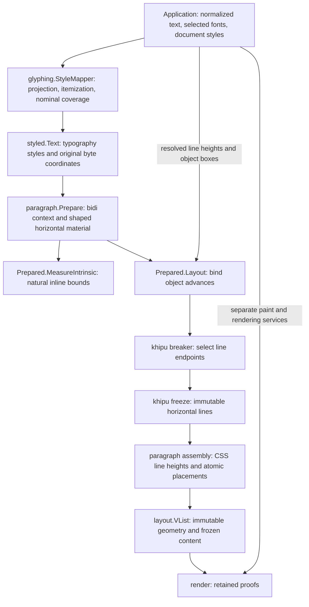

# Paragraph building and glyphing

This document explains the architecture behind
[the paragraph client guide](../glyphing/paragraph/README.md). Detailed geometry
and continuation contracts remain in [VLIST_CONTRACT.md](VLIST_CONTRACT.md) and
[FLOW.md](FLOW.md); this overview does not replace them.

## Responsibilities and data flow

Applications normalize input, select/load fonts, resolve document layout values
and retain paint. `glyphing.StyleMapper` maps styles to preselected faces and
itemizes text. `glyphing/paragraph` then coordinates bidi preparation, horizontal
typesetting and vertical assembly. Shared `layout` values are the completed
output; the independent `render` branch consumes that output with paint.

`Run` is the one-shot text-only route: bidi construction, fresh encoding,
breaking, freezing and assembly. It does not internally create a reusable
`Prepared` handle. `Prepare` separates width-independent work from measurement
and repeated layouts, and permits opaque inline objects whose final geometry is
not yet known. Neither route repeats itemization or acquires fonts.

The generic pipeline uses khipu contracts, not concrete OpenType types. The
glyphing adapter owns font parsing, metrics, scaling, nominal coverage and
streaming shaping; the rendering adapter independently owns outlines. Shaping
and coverage `CheckFace` acceptance belongs only to the glyphing adapter and is
never forwarded to `opentype/otshape`. See
[font selection](FONT_INTF.md) and [font/shaper acceptance](FONT_SHAPER.md).

## Retained preparation versus layout results

A `Prepared` retains source styles, paragraph-wide bidi data and reusable shaped
base material. Atomic anchors identify original U+FFFC occurrences without giving
them a font or text style. Binding supplies advances for those occurrences in
fresh working material; line breaking and freezing choose the horizontal output
for that request. Hyphenation policy belongs to preparation. Supported lazy
replacement batches are shared across measurement/layout, while unsuccessful
batches remain retryable.

Intrinsic measurement uses natural horizontal advances and supported break
opportunities, not vertical metrics, final atomic heights, side skips or generated
fill. The bounded explicit-hyphenation policy is not general CSS min/max-content
conformance. Fixed atomic border boxes and resolved margins are application input;
neither preparation nor assembly computes an object's interior or CSS edges.

Source/style/font services remain borrowed and stable. Copying configuration and
request slices does not clone arbitrary implementations. Serialize operations
sharing preparation or mutable services. Public results share frozen content and
stable resources, with detached geometry and diagnostic slices. No mutable
encoding/binding owner is published. Failures expose no partial output and cannot
mutate earlier results; staged errors preserve their underlying causes.

Process paragraphs in turn. Keep preparation and continuation checkpoints only
while that paragraph needs layout, continuation or retry. Drop all working handles
after completion or abandonment; frozen fragments retain the source and services
they need independently. There is no cross-paragraph cache or explicit `Close`.
The [flow lifecycle](FLOW.md#paragraph-lifecycle) specifies this boundary in detail.

## Vertical assembly and coordinates

CSS assembly requires source styles as well as frozen horizontal material:
surviving spaces obtain their metrics from the source, while glyph-bearing runs
use retained metrics. Explicit streaming defaults provide the paragraph strut.
Line-height is separate from shaping styles, so changing it does not change
glyph selection or feature domains. Text contributions use half-leading; atomic
boxes use bottom-margin-edge alignment. Baseline-relative extents may be signed.

Each line contributes one full-height CSS line box. Boxes abut, with no added
interline/trailing gap; they are logical boxes, not ink bounds. Private assembly
state is validated and copied when published as `layout.VList`. Input dimensions
use DU; placement coordinates use fractional big points with downward-positive Y.
Original UTF-8 coordinates, scalar glyph anchors and physical traversal remain
intact. Exact placement anchors and bounded geometry must not be repaired by
rounding, sorting atomics by X or narrowing coordinates through integer DU.

The [VList contract](VLIST_CONTRACT.md) defines struts, negative leading, empty
output, arithmetic tolerances and publication invariants. Unboxing recovers
immutable full-height items without retaining a VList backlink; surrounding
margins remain application-owned. Restacking and elasticity are still proposals
in [VLIST_PLAN.md](VLIST_PLAN.md), not paragraph APIs.

## Fragmentation and continuation

`Fragment`, `SplitFragment` and compatible `FitFragment` calls operate only on
retained geometry. They preserve complete line heights and horizontal/source
identity, rebasing the remainder and its atomic origins together. Their call
graphs must not invoke font services, binding or breaking. A public reuse key
attests unchanged inputs; frozen geometry alone cannot certify source/style
identity. A standalone fit requires a uniform-width frozen owner.

`Continuation` instead owns a private identity and accepted width history.
Equal-width flow uses the same geometry-only fitting core, including after an
A/B width change. Different-width flow certifies a khipu checkpoint and resumes
first-fit search after the locked prefix; it retains original styles, bidi
context and shaping. It currently binds, freezes and assembles the complete
combined path, then publishes the new tail alongside the previously retained
prefix fragments. Prefix search and base shaping are not repeated, but prefix
metric/materialization work can be. No suffix-proportional cost is promised.

Frames supply dimensions, not replacement paragraph styles. Each accepted
fragment keeps its own frozen owner; callers must not fabricate a single-owner
VList from fragments produced by different continuation layouts. Paragraph-global
optimality is deliberately relaxed. [FLOW.md](FLOW.md) contains the checkpoint
model, width-history rules, application scheduling boundary and upstream bidi
rejection/stall limitations. Cancellation cannot interrupt every synchronous
collaborator, particularly initial bidi resolution.

## Verification and evidence

Owning tests cover geometry, signed/zero dimensions, source/feature identity,
atomic traversal, retry/cancellation, ownership and preparation collection.
Sealed service traps and resolved-call audits protect the geometry-only path;
mutation tests exercise forbidden calls hidden in delegated helpers. Cross-branch
rendering tests live in [integration](../integration/README.md); application
scheduling, nested document proofs and replay belong to sibling tytui.

Current measurement methodology and release limits are in
[FLOW_COSTS.md](FLOW_COSTS.md) and [the production harness](flow-cost/README.md).
Its benchmark families separate preparation, initial layout and post-layout flow,
with phase/work counts and zero-call gates independent of timing. Original-cut
percentages describe the initial A-width layout. Historical experiment reports,
sources and raw measurements remain in [the archive](history/flowexperiment/README.md);
they are not current production validation and must not be regenerated as such.
