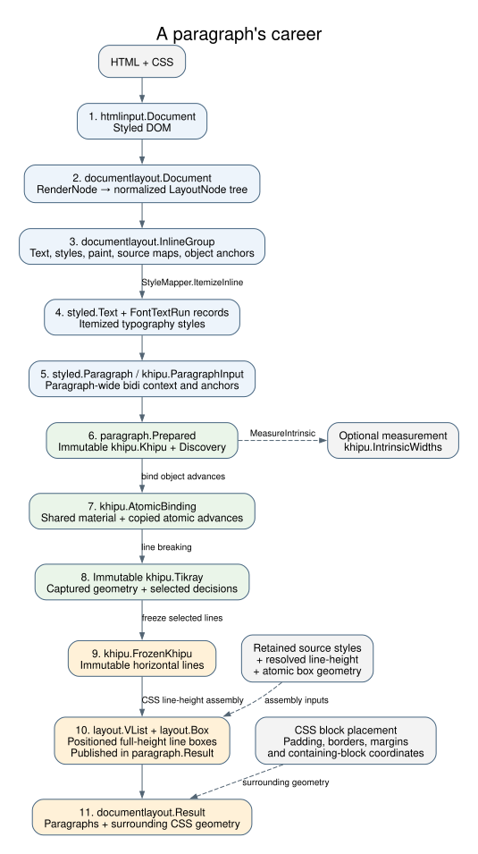

> This document records design or measurements from an earlier execution API.
> For the supported preparation, trial, checkpoint and prefix-refitting APIs,
> use the [paragraph guide](../glyphing/paragraph/README.md). Historical timings
> are not measurements of the current implementation.

# Paragraph building and glyphing

This document explains the architecture behind
[the paragraph client guide](../glyphing/paragraph/README.md). Detailed geometry
and continuation contracts remain in [VLIST_CONTRACT.md](VLIST_CONTRACT.md) and
[FLOW.md](FLOW.md); this overview does not replace them.

## A paragraph's career: HTML to VBox

A paragraph evolves through **document structure → styled text → shaped
horizontal material → broken lines → vertically positioned line boxes**.
These are successive representations, not mutations of one object. Source
mappings, paint and surrounding CSS geometry remain alongside the typesetting
representations.

The finished paragraph “VBox” is currently a **`layout.VList` with a `layout.Box`
describing its dimensions**. There is no separate paragraph `VBox` type. This
VList is a completed natural stack of full-height lines, not an elastic vertical
list or the surrounding CSS block.

The diagram and table describe the `tycli`/`documentlayout` integration route.
Typography uses the PR 2 contracts below; application adoption and the complete
cross-module baseline are recorded in [PR 3](REFLOW_PR3.md). Solid
arrows show the main transformations; dashed arrows show retained inputs or
optional queries. This is a data-flow diagram; CSS callback scheduling is
explained below.



[Graphviz DOT source](PARAGRAPH_CAREER.dot). Regenerate from the typography root:

```sh
dot -Tsvg doc/PARAGRAPH_CAREER.dot -o doc/PARAGRAPH_CAREER.svg
```

| Stage and data structures | Module/package | Purpose | Limitations |
| --- | --- | --- | --- |
| **1. Styled HTML:** `htmlinput.Document`, `htmlinput.Node`, backed by `styledtree.StyNode` | `tytui/htmlinput`; `w3c-dom/styledtree` | Retains document structure, decoded text, attributes, CSS style context and original source identities. | No glyphs, line breaks or final geometry. DOM text offsets are not offsets into original HTML bytes. |
| **2. Normalized box structure:** `RenderNode` → `LayoutNode`, retained by `documentlayout.Document` | `css-box-layout/layout`; `tytui/documentlayout` | Produces the structure CSS lays out, including anonymous inline groups and atomic inline boxes. | Still structural, not typeset. An HTML element and a typesetting paragraph are not necessarily one-to-one; normalization can produce several groups. |
| **3. Extracted paragraph input:** `documentlayout.InlineGroup` | `tytui/documentlayout` | Collects one group's normalized text, style spans, paint, line-height values, bidi isolates and source correspondence. Inline objects become U+FFFC markers with `AtomicAnchor` IDs. | No font bindings or glyphs. Object interiors remain separate boxes/groups and are not flattened into the enclosing paragraph. |
| **4. Itemized text:** `styled.Text`, accompanied by `[]glyphing.FontTextRun` | `cords/styled`; `typography/glyphing` | `StyleMapper.ItemizeInline` selects preloaded faces, resolves grapheme fallback and attaches typography styles. `FontTextRun` records selected-font associations. | Still text, not shaped glyphs. Nominal character coverage does not guarantee script/language shaping support. Paint stays outside this text. |
| **5. Bidi paragraph:** `styled.Paragraph`, passed through `khipu.ParagraphInput` | `cords/styled`; `khipu` | Establishes paragraph-wide direction and resolved bidi levels, including isolates, and couples that context with atomic anchors. | No line boundaries. The upstream bidi implementation has documented rejection/stall cases and is not fully cancellable mid-call. |
| **6. Reusable preparation:** `paragraph.Prepared`, retaining immutable `khipu.Khipu` and `Discovery` | `typography/glyphing/paragraph`; `khipu` | Constructs and retains base knots and shaping records, together with source styles and bidi context, for measurement and repeated layouts. Atomic slots remain unbound. | Reusable working state, not completed layout output. No target width, final object geometry or vertical arrangement. Hyphenation policy is fixed; operations sharing preparation/services must be serialized. |
| **7. Bound atomic advances:** `khipu.AtomicBinding` | `khipu` | Binding copies atomic advances in canonical occurrence order and shares immutable base knots and shaping records. | Immutable material/advance pairing, without break decisions or vertical geometry. |
| **8. Break decisions:** immutable `khipu.Tikray` | `khipu/linebreak/firstfit` or `knuthplass` | Retains line endings, selected replacements, binding, captured widths/skips and policy attribution. | Decisions belong to one material incarnation and binding. A breakpoint list alone is neither a rendered paragraph nor a portable continuation token. |
| **9. Frozen horizontal lines:** `FrozenKhipu`, `FrozenLine`, `FrozenKnot` | `khipu` | Captures immutable selected content, allocated horizontal spacing, line membership and physical traversal. | No paragraph-level vertical placement. Frozen material alone cannot supply source-style metrics for surviving spaces during CSS assembly. |
| **10. Boxed paragraph:** `layout.VList`, `layout.Line`, `layout.Box`, published in `paragraph.Result` | `typography/layout`; `typography/glyphing/paragraph` | Adds baselines, full CSS line heights, line tops and atomic border origins while retaining frozen horizontal content. | Logical geometry, not ink bounds. Excludes surrounding block margins, padding and borders; no vertical stretch/shrink or target-height packing. |
| **11. Positioned document result:** `documentlayout.Result`, `GroupResult`, `LayoutGeometryTable` | `tytui/documentlayout`; `css-box-layout/layout` | Combines paragraph VLists with source/paint associations and surrounding CSS box positions. | A layout snapshot, not rendering output. Outlines/proofs are produced separately by the `render` branch. |

## Who drives the transformations?

Applications normalize input, select/load fonts, resolve document layout values
and retain paint. CSS core decides when a normalized inline group needs
measurement or final layout; typography decides how to typeset it.

1. The application calls `documentlayout.Document.Layout`.
2. The adapter invokes CSS `FlowLayout` with measurement/layout callbacks.
3. CSS determines available width and nested object dimensions, then calls
   `LayoutInline`. For automatic widths it may first call `MeasureInline`.
4. The adapter extracts and itemizes the group, prepares it if necessary, and
   calls `Prepared.Layout`. Measurement and layout share invocation-local
   preparation.
5. Typography returns the frozen paragraph and VList. The adapter retains these
   details and returns extent, atomic positions and collapse eligibility to CSS.
6. CSS completes surrounding block placement, including padding, borders and
   margin collapsing. It does **not** restack the paragraph's lines. The adapter
   publishes paragraphs and document geometry together after whole-document success.

`tytui/documentlayout` is the headless integration adapter used by `tycli` as
well as the TUI; the TUI event loop is not involved in these callbacks. Its module
location is not an architectural requirement. See the
[documentlayout call sequence](../../tytui/documentlayout/README.md#call-flow-css-initiates-paragraph-layout).

`Run` is the one-shot text-only route: bidi construction, fresh encoding,
breaking, freezing and assembly. It does not internally create a reusable
`Prepared` handle. `Prepare` separates width-independent work from measurement
and repeated layouts, and permits opaque inline objects whose final geometry is
not yet known. Neither route repeats itemization or acquires fonts.

The generic pipeline uses khipu contracts, not concrete OpenType types. The
glyphing adapter owns font parsing, metrics, scaling, nominal coverage and
streaming shaping; the rendering adapter independently owns outlines. Shaping
and coverage `CheckFace` acceptance belongs only to the glyphing adapter and is
never forwarded to `opentype/otshape`. See
[font selection](FONT_INTF.md) and [font/shaper acceptance](FONT_SHAPER.md).

## Retained preparation versus layout results

`paragraph.Prepared` privately retains an immutable SoA `khipu.Khipu` and its
matching synchronized `Discovery`. These are reusable material, not completed
layout. `AtomicBinding` and `Tikray` are also immutable; completed horizontal and
vertical layout is published as `FrozenKhipu` and `VList`.

**Preparation already constructs the base knots.** `PrepareParagraph` shapes the
text and compiles base knots, shaping records and source associations. Atomic
slots remain unbound. Discovery memoizes complete lazy replacement batches for
measurement and layout; failures remain retryable. Selection of a replacement
belongs to a trial, never to shared material or discovery.

**Binding supplies atomic advances without copying the base knot planes.**
`BindParagraph` returns an immutable `AtomicBinding` with copied canonical
advances, sharing the Khipu. It performs no shaping or discovery. The breaker
creates private search state and publishes a complete `Tikray`; `Freeze(plan)`
uses that trial's captured geometry and selected alternatives without callbacks.

**Independent Tikrays provide trial isolation.** A width change need not change
the binding, and later success or failure cannot overwrite an earlier trial's
decisions. Typography currently makes a fresh binding per layout/changed-width
continuation and fully freezes/assembles the selected plan. Equal-width flow
bypasses all of that by reusing frozen lines. Broader client-facing trial APIs
remain deferred to PR 4; current `Prepared.Layout` publishes only completed
results. See [the contracts](REFLOW_KHIPU.md) and [binding](../../khipu/khipu.go).

Intrinsic measurement uses natural horizontal advances and supported break
opportunities, not vertical metrics, final atomic heights, side skips or generated
fill. The bounded explicit-hyphenation policy is not general CSS min/max-content
conformance. Fixed atomic border boxes and resolved margins are application input;
neither preparation nor assembly computes an object's interior or CSS edges.

Source/style/font services remain borrowed and stable. Copying configuration and
request slices does not clone arbitrary implementations. Serialize operations
sharing preparation or mutable services. Public results share frozen content and
stable resources, with detached geometry and diagnostic slices. Failures expose
no partial output and cannot mutate earlier results; staged errors preserve
their underlying causes.

Process paragraphs in turn. Keep preparation and continuation checkpoints only
while that paragraph needs layout, continuation or retry. Drop all working handles
after completion or abandonment; frozen fragments retain the source and services
they need independently. There is no cross-paragraph cache or explicit `Close`.
Ordinary document layout keeps its preparation table private to the invocation
and releases it after completion; it never publishes that table in the document
result. The [flow lifecycle](FLOW.md#paragraph-lifecycle) specifies the sequential
paragraph lifecycle for frame flow in detail.

## Vertical assembly and coordinates

CSS assembly requires source styles as well as frozen horizontal material:
surviving spaces obtain their metrics from the source, while glyph-bearing runs
use retained metrics. Explicit streaming defaults provide the paragraph strut.
Line-height is separate from shaping styles, so changing it does not change
glyph selection or feature domains. Text contributions use half-leading; atomic
boxes use bottom-margin-edge alignment. Baseline-relative extents may be signed.

Each line contributes one full-height CSS line box. Boxes abut, with no added
interline/trailing gap; they are logical boxes, not ink bounds. Private assembly
state is validated and copied when published as `layout.VList`. Input dimensions
use DU; placement coordinates use fractional big points with downward-positive Y.
Original UTF-8 coordinates, scalar glyph anchors and physical traversal remain
intact. Exact placement anchors and bounded geometry must not be repaired by
rounding, sorting atomics by X or narrowing coordinates through integer DU.

The [VList contract](VLIST_CONTRACT.md) defines struts, negative leading, empty
output, arithmetic tolerances and publication invariants. Unboxing recovers
immutable full-height items without retaining a VList backlink; surrounding
margins remain application-owned. Restacking and elasticity are still proposals
in [VLIST_PLAN.md](VLIST_PLAN.md), not paragraph APIs.

## Fragmentation and continuation

`Fragment`, `SplitFragment` and compatible `FitFragment` calls operate only on
retained geometry. They preserve complete line heights and horizontal/source
identity, rebasing the remainder and its atomic origins together. Their call
graphs must not invoke font services, binding or breaking. A public reuse key
attests unchanged inputs; frozen geometry alone cannot certify source/style
identity. A standalone fit requires a uniform-width frozen owner.

`Continuation` instead owns a private identity and accepted width history.
Equal-width flow uses the same geometry-only fitting core, including after an
A/B width change. Different-width flow certifies a checkpoint from the retained Tikray and resumes
first-fit search after the locked prefix; it retains original styles, bidi
context and shaping. Accepted widths/skips come from the checkpoint, while the
new width callback serves only suffix lines. It currently binds, freezes and assembles the complete
combined path, then publishes the new tail alongside the previously retained
prefix fragments. Prefix search and base shaping are not repeated, but prefix
metric/materialization work can be. No suffix-proportional cost is promised.

Frames supply dimensions, not replacement paragraph styles. Each accepted
fragment keeps its own frozen owner; callers must not fabricate a single-owner
VList from fragments produced by different continuation layouts. Paragraph-global
optimality is deliberately relaxed. [FLOW.md](FLOW.md) contains the checkpoint
model, width-history rules, application scheduling boundary and upstream bidi
rejection/stall limitations. Cancellation cannot interrupt every synchronous
collaborator, particularly initial bidi resolution.

## Verification and evidence

Owning tests cover geometry, signed/zero dimensions, source/feature identity,
atomic traversal, retry/cancellation, ownership and preparation collection.
Sealed service traps and resolved-call audits protect the geometry-only path;
mutation tests exercise forbidden calls hidden in delegated helpers. Cross-branch
rendering tests live in [integration](../integration/README.md); application
scheduling, nested document proofs and replay belong to sibling tytui.

Current measurement methodology and release limits are in
[FLOW_COSTS.md](FLOW_COSTS.md) and [the production harness](flow-cost/README.md).
Its benchmark families separate preparation, initial layout and post-layout flow,
with phase/work counts and zero-call gates independent of timing. Original-cut
percentages describe the initial A-width layout. Historical experiment reports,
sources and raw measurements remain in [the archive](history/flowexperiment/README.md);
they are not current production validation and must not be regenerated as such.
