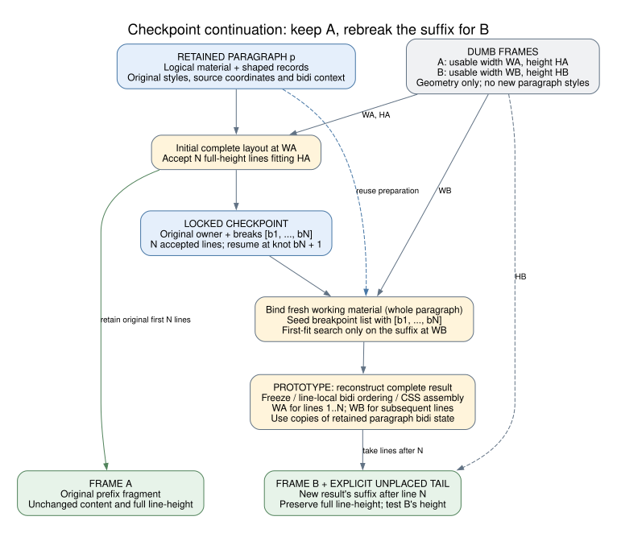

# E3 cost measurements and decision

Measured 2026-11-18. E3 completes the bounded experiment; no production flow API,
application dispatcher, renderer integration or elasticity has been implemented.
The upstream bidi fix remains deferred.

## Decision

Proceed with **application integration design for compatible equal-width frozen
fragments**. This path avoids font work and horizontal layout, and is substantially
cheaper in every measured case. It needs no new paragraph/breaker API. It still
walks/copies geometry and retains the complete frozen owner; it is not constant
time. Fragment-aware rendering and application margin/source/paint ownership must
be addressed in that separate integration work.

Fixed-prefix, NoHyphenation continuation is semantically viable, but **do not
promise cost proportional to the suffix**. Resuming the search helps modestly;
full binding, freezing and CSS assembly dominate. A complete-path continuation
is a viable slower implementation route for the admitted cases. Different-width
flow remains a required capability for the intended use cases; calling it a
"fallback" describes cost, not optional functionality. General production support
still needs its admission limits addressed.
The measurements do not justify broadening parshape or introducing a generalized
page scheduler. They do justify preserving prepared logical material instead of
reshaping the paragraph for every frame.

## What continues at the frame boundary

Frames A and B are **dumb containers**. The application/CSS layer resolves their
usable widths, available heights and placement. Frame geometry constrains line
layout, but moving `p` into B does not make it inherit B's font, size, language,
direction or line-height. Paragraph styles, source/feature coordinates and
paragraph-wide bidi context stay with the original preparation. Fixed inline
object geometry is also retained in this bounded model; surrounding margins
remain application-owned.

The experiment implements a **resumable first-fit breaker with an explicit
checkpoint**. After A accepts `N` lines, the checkpoint retains all their logical
knot breakpoints and is tied to the original preparation and initial result.
The next call seeds the breakpoint list with this locked prefix and searches
from the knot immediately after its last breakpoint. It uses A's width for lines
`1..N` and B's width thereafter. For example:

```text
Original breaks:  [12, 25, 38, 51, 64]
Locked A prefix:  [12, 25]                 (two accepted lines)
Resume at knot:   26
Combined breaks: [12, 25, 33, 41, 49, 57, 64]
Widths:          [WA, WA, WB, WB, WB, WB, WB]
```

These are illustrative knot indexes, not source byte positions. The last locked
breakpoint remains the A/B line boundary; it cannot move or be crossed by new
break decisions. Normal line-edge trimming applies. No newline, paragraph
separator or new penalty is inserted, and the suffix is not re-knotted from
source. Fresh binding copies working Khipu storage from retained preparation,
sharing immutable shaping records without reshaping base text.

The prototype still binds, freezes and assembles the **complete combined path**.
That repeated work explains the measured prefix-dependent costs. It does not
mean the whole paragraph is rebroken at B's width: new breakpoint search covers
only the suffix. Publication keeps A's original frozen fragment and takes B plus
any unplaced tail from the new result after line `N`. The benchmark named
`relayout-narrow` is the separate whole-paragraph-at-B-width cost comparator;
it is not the continuation algorithm.



[Graphviz DOT source](../../FLOW_CONTINUATION.dot) and
[the full model and regeneration command](../../FLOW.md#checkpoint-based-continuation-the-working-model).
The diagram illustrates the resumed candidate at an interior cut. With no
accepted lines, search starts at the beginning; when all lines fit A, the initial
result is reused without continuation.

Paragraph bidi resolution is retained unchanged. For the new line boundaries,
khipu clones it and applies line-specific whitespace handling (L1) and visual
reordering (L2). An isolate beginning in A keeps its context in B. The prototype
does this over the complete combined path and still publishes the original A
fragment. It never treats B's text as a new bidi paragraph.

"Resumable" means a fresh call with an owner-bound checkpoint, not concurrent
use of one preparation or resumption of a suspended Knuth–Plass search. Calls
sharing preparation remain serialized. E2 can keep a KP prefix but always uses
first-fit for the suffix. NoHyphenation avoids discretionary carry in these
checkpoints; general hyphenation needs additional state and validation. The
accepted trade-off is giving up paragraph-global optimization while preserving
the accepted prefix, source context, full line-height and immutable ownership.

## Method and scope

- Go 1.25.6, macOS 26.3, darwin/arm64, Apple M1. Five sequential **fresh Go test
  processes**, `-cpu=1`, `-benchtime=50ms`, `-benchmem`, `-count=1`; no race
  instrumentation or concurrent verification runs during sampling. Go may use
  only one timed iteration for expensive preparations. CPU affinity/frequency
  and other host applications were not controlled.
- Seven datasets: synthetic 100/1,000/10,000 words; offline Gentium Plus Latin
  and Noto Sans Hebrew at 100/1,000 words. The real-font set is deliberately
  small. Fonts are loaded by the normal OpenType adapter from existing sibling
  fixtures; nothing is downloaded, discovered or parsed with relaxed rules.
- Fresh preparation means a new paragraph bidi/shaping preparation, with
  pre-itemized input and already loaded, warmed font services. File I/O, parsing,
  nominal coverage and itemization are outside the measured interval. This is
  not cold-font or complete application startup cost.
- Warm operations share one prepared paragraph and successful A-width initial
  layout, using first-fit, NoHyphenation, 10 bp em, full CSS factor-1.2 line
  height, explicit zero side skips and no space stretch/shrink. A = 300 bp;
  narrow B = 225 bp. B's content height is 30,000 bp, within the finite domain,
  so all suffixes fit; admission rejects errors, overfull lines and dropped tails.
- Nominal prefix fractions are 10%, 50%, 90%, rounded to an interior initial
  line boundary. Raw `accepted-percent` records the realized fraction. At only
  five initial lines, the 100-word Hebrew case realizes 20%, 40%, 80%; larger
  cases are closer to the nominal fractions. No line box is partially consumed.
- `equal` measures E1's complete guarded split. `reference` and `resumed` measure
  E2's complete two-frame operation, including cut selection, checkpoint creation,
  validation, full result publication and B/tail placement. `relayout-equal` and
  `relayout-narrow` reuse preparation but redo the **whole** paragraph at A or B
  width and split its result. Relayout is a cost comparator that can change the
  accepted prefix, not a correctness oracle or interchangeable output policy.
- The separate fixed-suffix series retains exactly 100 synthetic `aa` words
  (299 source bytes) after prefixes of 0, 900 and 9,900 words. A = 145 bp fits
  exactly ten words per initial line; B = 108.75 bp. Core continuations reuse an
  existing checkpoint; checkpoint creation is measured separately. Complete frame
  measurements above include its creation on every operation.

All timings are of the **instrumented experimental overlay**, not production
speed guarantees. Phase clocks surround binding, breaking, freezing and assembly;
they do not time individual knots. Freezing includes logical materialization,
line-local bidi ordering and width allocation. Assembly includes metrics, atomic
placement and publication. Other validation/checkpoint/fragment work remains in
the total. Phase durations include any pauses within their intervals. Total
allocations are reported; no per-phase allocation or peak-memory claim is made.
Synthetic service counters add atomic increments. Real faces remain untouched;
their stream factory/Shape/CheckFace calls are counted through forwarding services.

## Complete frame operations

Times below are **median [minimum, maximum] microseconds** across the five process
samples, at the nominal midpoint cut. Full raw results and `summary.json` contain
every prefix fraction, allocation count, phase duration, operation count and CV.

| Backend / words | Equal split | Reference | Resumed | Relayout equal | Relayout narrow |
| --- | --- | --- | --- | --- | --- |
| Synthetic / 100 | 5.6 [5.5, 5.7] | 150.2 [149.9, 153.8] | 143.1 [142.4, 144.4] | 151.3 [149.6, 152.2] | 157.3 [156.8, 158.3] |
| Synthetic / 1,000 | 49.3 [48.8, 50.7] | 1,440 [1,421, 1,596] | 1,357 [1,341, 1,506] | 1,463 [1,456, 1,582] | 1,522 [1,508, 1,676] |
| Synthetic / 10,000 | 400 [396, 405] | 12,873 [12,770, 13,553] | 12,067 [12,019, 12,318] | 13,286 [13,230, 14,221] | 13,917 [13,575, 15,032] |
| Gentium / 100 | 5.0 [4.9, 5.1] | 139.7 [138.1, 145.6] | 131.8 [131.1, 138.0] | 140.4 [138.9, 145.7] | 150.6 [149.3, 155.0] |
| Gentium / 1,000 | 41.0 [40.3, 44.5] | 1,324 [1,311, 1,379] | 1,257 [1,220, 1,263] | 1,343 [1,309, 1,365] | 1,447 [1,427, 1,505] |
| Hebrew / 100 | 4.0 [3.9, 4.0] | 124.0 [123.7, 128.4] | 117.3 [116.7, 119.0] | 125.2 [124.1, 127.4] | 130.9 [130.2, 133.5] |
| Hebrew / 1,000 | 30.3 [30.0, 30.7] | 1,157 [1,151, 1,176] | 1,082 [1,076, 1,095] | 1,211 [1,204, 1,223] | 1,291 [1,265, 1,303] |

Late cuts save more search than early cuts, without eliminating prefix work.
At 10,000 synthetic words the resumed medians are 13.77 / 12.07 / 10.42 ms
at nominal 10% / 50% / 90%, against reference 14.06 / 12.87 / 11.73 ms.
Do not infer significance from small differences whose sample ranges overlap.

Allocation traffic also distinguishes the paths. At the midpoint cut:

| Backend / words | Equal MiB / allocations | Reference MiB / allocations | Resumed MiB / allocations | Relayout narrow MiB / allocations |
| --- | --- | --- | --- | --- |
| Synthetic / 10,000 | 1.40 / 21 | 32.20 / 124,673 | 32.20 / 124,668 | 30.54 / 133,085 |
| Gentium / 1,000 | 0.118 / 21 | 3.062 / 11,566 | 3.062 / 11,565 | 3.138 / 12,582 |
| Hebrew / 1,000 | 0.061 / 21 | 2.294 / 6,994 | 2.294 / 6,994 | 2.355 / 7,491 |

These are median cumulative bytes and allocations **per operation**, not retained
or peak memory. Resumed search does not substantially reduce the full-path copies.

## What remains proportional to the prefix

With exactly 100 words left, resumed core phase medians are in microseconds:

| Prefix words | Bind | Break | Freeze | CSS assembly | Total median [min, max] | Allocated MiB / allocations |
| --- | --- | --- | --- | --- | --- | --- |
| 0 | 6.5 | 39.7 | 68.4 | 29.6 | 146.4 [145.9, 147.2] | 0.237 / 1,416 |
| 900 | 44.5 | 41.5 | 687.7 | 258.6 | 1,037.7 [1,033.6, 1,040.1] | 2.396 / 10,359 |
| 9,900 | 432.8 | 49.8 | 5,180.5 | 2,694.7 | 8,420.2 [8,238.4, 8,580.8] | 25.312 / 99,508 |

Exact operation counters explain this growth:

| Prefix words | Resumed searched knots (prefix / total) | Bound and materialized knots (prefix / total, each) | Boundary indexes checked | CSS lines assembled |
| --- | --- | --- | --- | --- |
| 0 | 0 / 200 | 0 / 200 | 0 | 15 |
| 900 | 0 / 200 | 1,800 / 2,000 | 90 | 105 |
| 9,900 | 0 / 200 | 19,800 / 20,000 | 990 | 1,005 |

The constrained reference searches all 200 / 2,000 / 20,000 knots. Even the
resumed breaker call is not strictly constant-time: it validates/copies the
growing prefix boundary list. Independent checkpoint creation costs a median
0.277 / 7.759 / 71.078 microseconds, and allocates 1,608 / 17,224 / 155,720 bytes.
It validates prefix knots and obtains a copied full visible-line slice when
checking the cut. These costs are outside the core table but inside frame totals.

All warm operations have zero additional stream factories, Shape and CheckFace
calls. Equal splitting also traps every synthetic service call. Its zero
binding/breaker counters rely on E1's typed call audit and service traps, not a
global breaker interceptor. Reference/resumed binding/materialization counters
observe the actual owning loops. With 9,900 prefix words the resumed core still
makes 10,002 synthetic metric queries and 40,010 conversions while assembling
the complete paragraph; keeping a small suffix does not bypass prefix metrics.

## Workload sensitivity

The mixes describe **post-initial-layout operation cost**, not total page layout.
For each process sample and prefix, compute
`p*equal + (1-p)*resumed`, and compare with
`p*relayout-equal + (1-p)*relayout-narrow`.
The 90% share is the user's workload assumption; 50% tests sensitivity. No
document frequency measurement or application scheduling cost is inferred.

At the nominal midpoint, medians in milliseconds and sample ratio ranges are:

| Backend / words | 90/10 retained / relayout | Relayout-to-retained ratio [min, max] | 50/50 retained / relayout | Ratio [min, max] |
| --- | --- | --- | --- | --- |
| Synthetic / 100 | 0.019 / 0.152 | 7.84 [7.78, 7.87] | 0.074 / 0.154 | 2.07 [2.05, 2.08] |
| Synthetic / 1,000 | 0.180 / 1.468 | 8.15 [8.10, 8.28] | 0.703 / 1.494 | 2.11 [2.09, 2.15] |
| Synthetic / 10,000 | 1.566 / 13.350 | 8.53 [8.47, 8.99] | 6.234 / 13.602 | 2.19 [2.16, 2.30] |
| Gentium / 100 | 0.018 / 0.141 | 7.97 [7.96, 8.04] | 0.068 / 0.146 | 2.12 [2.09, 2.14] |
| Gentium / 1,000 | 0.163 / 1.354 | 8.37 [8.15, 8.46] | 0.649 / 1.395 | 2.16 [2.14, 2.21] |
| Hebrew / 100 | 0.015 / 0.126 | 8.24 [8.13, 8.36] | 0.061 / 0.128 | 2.11 [2.10, 2.14] |
| Hebrew / 1,000 | 0.135 / 1.220 | 8.98 [8.92, 9.04] | 0.556 / 1.250 | 2.25 [2.23, 2.26] |

Across all prefix fractions the median ratios range from 7.22–10.26 for 90/10
and 1.86–2.65 for 50/50. These are ratios of measured **different output
policies**; they justify investigating retained flow, not substituting relayout
where fixed-prefix correctness is required. Mixture allocation distributions
are retained in the machine-readable summary alongside the timing distributions.

## Fresh preparation and the large-font pilot

Each sample creates new paragraph preparation; stable warmed font services are
reused. Timing is median [min, max] milliseconds:

| Backend / words | Fresh preparation | Allocated MiB / allocations |
| --- | --- | --- |
| Synthetic / 100 | 4.20 [4.02, 8.36] | 3.80 / 35,219 |
| Synthetic / 1,000 | 47.02 [44.65, 90.77] | 38.81 / 357,707 |
| Synthetic / 10,000 | 1,148.39 [1,127.60, 1,165.80] | 402.49 / 3,746,356 |
| Gentium / 100 | 61.43 [59.76, 66.51] | 51.73 / 3,350,538 |
| Gentium / 1,000 | 1,396.94 [1,375.71, 1,407.52] | 1,143.35 / 77,011,806 |
| Hebrew / 100 | 3.54 [3.48, 3.62] | 2.86 / 38,152 |
| Hebrew / 1,000 | 38.91 [38.46, 39.48] | 28.01 / 394,385 |

The synthetic small-preparation samples show substantial dispersion; the ranges
must accompany the medians. The 50 ms target is not a minimum number of iterations.

The earlier **single-iteration pilot**, kept separately, also completed the
10,000-word real-font cases. Gentium preparation took 20.57 seconds and allocated
17.02 GB cumulatively (1.10 billion allocations); Hebrew took 0.934 seconds and
allocated 413 MB cumulatively. These are not five-sample estimates. To keep the
repeated experiment bounded, both real-font series stop at 1,000 words; only
synthetic input spans all three required scales in the repeated matrix. There
were no pilot/measurement fallbacks or benchmark failures. No large-font result
is folded into the smaller averages, and peak memory was not measured. The
preparation costs merit a separate upstream profile; no shaper/bidi optimization
was attempted here.

## API implications and limits

The smallest continuation mechanism demonstrated is the E2 owner-bound checkpoint
of a successful initial path, retaining source/bidi/request identity and ordinary
boundaries, plus a stable A-prefix/B-suffix width schedule and the existing
complete freeze/CSS publication path. Keep the experimental `Flow*` names out of
default builds. A source byte offset alone is insufficient, and neither Unbox
nor ElasticVList recovers the logical continuation state.

True suffix-proportional work needs more than a breaker entry: range binding,
range materialization/freezing, CSS metrics/assembly for retained suffix lines,
and safe composition of separately owned completed geometry. It must also avoid
whole-prefix validation/copies on every resume. Do not weaken VList's complete
frozen-owner contract to claim that optimization. Cost this separate upstream
design before committing to it; the frequent path already avoids those phases.

Correctness admission reuses E2's full frozen/source/prefix oracle and adds real
font fixtures plus a timed-versus-untimed output comparison. Existing ownership,
cancellation, failure/retry and dependency audits remain applicable. Benchmarks
cover first-fit text, not KP suffix optimization, discretionary carry, mixed-size
atomic performance, multi-frame scheduling, widow/orphan rollback, real document
workload distributions or renderer costs. Synthetic metrics do not establish
real-font shaping quality. Application margins remain outside these records.

The [upstream bidi rejection and stall cases](E2_RESULTS.md#upstream-bidi-limitations)
remain excluded and unfixed. These are failures of ordinary initial preparation,
reproduced without E2 seams before any frame split or continuation: one mixed
markup fixture returns `invalid logical bidi segment`, and other mixed RTL inputs
stall in the bidi parser. They are not consequences of preserving context across
the A/B boundary. The known rejection probe remains an explicit skip; the stalling
inputs are not launched inside the ordinary suite. Successful pure Hebrew
measurements cannot establish general mixed-bidi support or interruptible initial
preparation.

## Evidence and reproduction

See [the evidence directory](testdata/e3/results/2026-11-18/README.md) for raw
samples, the separate pilot, environment/source/font hashes, analysis and exact
commands. The analyzer rejects missing/failed/duplicate rows or an incomplete
five-process sample set. It summarizes 121 benchmark cases and derives paired
90/10 and 50/50 mixtures; no outliers were removed.

E3 implementation verification passed before this documentation clarification:

- Ordinary and race suites, build and vet in typography, tytui and khipu, both
  with default sources and with the E3 overlay (which includes E2).
- Ordinary and race suites, build and vet in css-box-layout with default sources.
- Experiment admission/regressions, generic dependency audits, adapter regressions
  and tytui's replay/document proof controls through those full suites.
- Three Python analysis regressions and successful strict analysis of all five
  complete benchmark logs; overlay generation, Go formatting and whitespace checks.

The existing explicitly skipped E2 bidi admission probe remains a known limitation,
not a passing case. No replay fixtures, sibling checkout sources or production
APIs were changed.

The checkpoint-model clarification changes documentation and its Graphviz diagram
only. Diagram rendering, local links and whitespace were checked; benchmark data
and executable sources were unchanged. Go suites and measurements were not rerun
for this documentation-only clarification.
